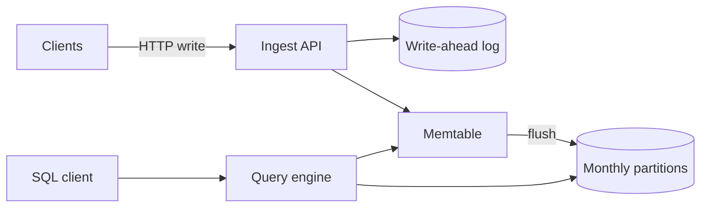

Some facts are shapes: how data flows through the server, how throughput grew
from one release to the next, what the dashboard looks like. OINK draws them
from text you keep in the page, a few lines of Mermaid, an ECharts option
block, a TeX formula, so a change shows up in review as a readable diff and
search finds the words inside. This chapter illustrates the Starter's
Architecture page, `content/docs/introduction/architecture.md`, and the
Overview beside it.

## A diagram from text {#mermaid}

Name a fence `mermaid` and write the diagram. This one shows how a write
reaches disk and how a query finds it:

````markdown {title="Source"}

````


There is nothing to configure. The Mermaid engine ships with the theme and runs
in the reader's browser, and only pages with a `mermaid` fence load it. A
corner button opens each diagram in a viewer where readers can pan and zoom.
[Mermaid](/docs/components/mermaid/)
covers sequence diagrams, Gantt charts and the rest.

## A chart from data {#echarts}

A benchmark is a table of numbers that readers understand faster as bars. An
`echarts` fence holds an ECharts option object in YAML, so the numbers stay in
your Markdown:

````markdown {title="Source"}
```echarts {height="300px"}
tooltip:
  trigger: axis
xAxis:
  type: category
  data: ['2.0', '2.4', '3.0']
yAxis:
  type: value
  name: million points/s
series:
  - name: ingest rate, 8 cores
    type: bar
    data: [1.2, 1.9, 3.4]
```
````

```echarts {height="300px"}
tooltip:
  trigger: axis
xAxis:
  type: category
  data: ['2.0', '2.4', '3.0']
yAxis:
  type: value
  name: million points/s
series:
  - name: ingest rate, 8 cores
    type: bar
    data: [1.2, 1.9, 3.4]
```

Hugo checks the options while it builds and warns with the line number if they
do not parse, and the chart follows light and dark mode.
[ECharts](/docs/components/echarts/) shows line, pie and combined charts.

## A formula {#math}

Readers sizing a server want the arithmetic. Formulas are TeX, rendered to
HTML and MathML by KaTeX while the site builds, but the `$$` and `\(…\)`
delimiters need Goldmark's passthrough extension, which the Starter does not
turn on. Add it to the `markup` block of `hugo.yaml`; Hugo does not inherit
`markup` settings from a theme, so OINK cannot do this for you:

```yaml {title="hugo.yaml"}
markup:
  goldmark:
    extensions:
      passthrough:
        enable: true
        delimiters:
          block: [['\[', '\]'], ['$$', '$$']]
          inline: [['\(', '\)']]
```

Keep the existing `renderer`, `parser` and `highlight` keys beside it. Then
write the estimate:

```markdown {title="Source"}
Disk use over a retention period is roughly:

$$
S = \frac{N \cdot f \cdot T \cdot b}{c}
$$

for \(N\) series written \(f\) times per second for \(T\) seconds, with \(b\)
bytes per raw point and a compression ratio \(c\), typically about 10.
```

Disk use over a retention period is roughly:

$$
S = \frac{N \cdot f \cdot T \cdot b}{c}
$$

for \(N\) series written \(f\) times per second for \(T\) seconds, with \(b\)
bytes per raw point and a compression ratio \(c\), typically about 10.

A single `$` is deliberately not a delimiter, so "$5" in prose stays a price.
[Chapter 7](/book/07-book/) numbers a formula like this one.

## Screenshots with captions {#images}

A screenshot that only one page uses belongs beside that page. Turn the page
into a page bundle: move `architecture.md` to `architecture/index.md` and put
the image in the same directory. The address does not change.

```filetree {title="A page bundle"}
- content/docs/introduction/
  - architecture/
    - index.md
    - index.zh.md
    - dashboard.webp   # shared by both languages
```

Write the image as ordinary Markdown in a paragraph of its own and add one
attribute line under it, touching it, for the caption:

```markdown {title="Source"}

{caption="The built-in dashboard at http://localhost:8086/ui after the first write."}
```

Here is the same pattern with an image from this site:


{caption="An image with a caption: the alt text describes the picture, the caption says why it is there." width=600 height=300}

The theme writes the image's size into the page so the text does not jump while
it loads. Set `params.ui.image_zoom: true` in `hugo.yaml` and readers can click
an image to open it full size. To compare screens side by side, write one image
per line in a `gallery` fence:

````markdown {title="Source"}
```gallery
 # Light mode
 # Dark mode
```
````

```gallery
 # Light mode
 # Dark mode
```

## A terminal recording {#asciinema}

An installation is easier to follow when watched, and an
[asciinema](https://asciinema.org/) recording keeps the output as text, so
readers can pause it and copy a command. Put the `.cast` file under `static/`
and name it in the shortcode:

```markdown {title="Source"}

```



This recording is a real six-minute installation of
[Pigsty](https://pigsty.io/) on Debian, about 196 KB. Record your own with
`asciinema rec install.cast`. The player ships with the theme and follows the
site's light and dark palette.

## Milestones on a timeline {#timeline}

The Overview page tells the project's history. A definition list with
`{.timeline}` under it lays the events along a line, each beside its marker:

```markdown {title="Source"}
2024-03
: **Acme DB 1.0.** A single-node server with SQL queries.

2025-02
: **Acme DB 2.0.** Monthly partitions and retention policies.

2026-10
: **Acme DB 3.0.** Tiered storage and three times the ingest rate.
{.timeline}
```

2024-03
: **Acme DB 1.0.** A single-node server with SQL queries.

2025-02
: **Acme DB 2.0.** Monthly partitions and retention policies.

2026-10
: **Acme DB 3.0.** Tiered storage and three times the ingest rate.
{.timeline}

Keep a blank line between entries and none before `{.timeline}`; the build
warns when the attribute line has come loose.

## Video, audio and more {#more}

Each of these has its own page with examples, when your content calls for it:

- [Video](/docs/components/video/) — A product demo as an MP4 beside the page, or a YouTube card that loads nothing until clicked.
- [Audio](/docs/components/audio/) — A podcast episode or a pronunciation sample with the browser's own player.
- [Draw.io](/docs/components/drawio/) — Diagrams you edit in diagrams.net and keep as SVG.
- [PlantUML](/docs/components/plantuml/) — UML diagrams rendered in the browser by a bundled engine.
- [Markmap](/docs/components/markmap/) — A Markdown outline drawn as a mind map.
- [Maps](/docs/components/map/) — Points on a map, once you name a tile service.
{.cards}

## What loads, and from where {#local-first}

Every engine in this chapter, Mermaid, ECharts, KaTeX's styles, the asciinema
player, is part of the theme, and a page loads only what its own content uses:
a page with one chart and no diagram downloads ECharts and not Mermaid. Nothing
contacts another server unless you configure it to. A map waits for a tile
service you name, and a YouTube card connects to YouTube only when the site
allows it and the reader clicks.

## Check your work {#checkpoint}

- The Architecture page shows the data-flow diagram and the benchmark chart, and both switch with light and dark mode.
- The formula renders after the passthrough block is in `hugo.yaml`; before it, `$$` shows as text.
- The screenshot sits in the page bundle, shows its caption, and opens full size when zoom is on.
- The Overview shows three releases on a timeline.

## Ask your agent {#agent}

```text {num="5-1" caption="Prompt: illustrate a page from text." #eg-agent-media}
Illustrate content/docs/introduction/architecture.md: add a Mermaid flowchart
of the write and query paths described in the text, and an ECharts bar chart
from the benchmark table in the same page. Keep the table too. If any page
uses $$ formulas, add Goldmark passthrough to hugo.yaml as described at
https://oink.pgsty.com/docs/components/math/. Turn the page into a bundle if
it gains images, give every image alt text and a caption, and check the
result in light and dark mode.
```
