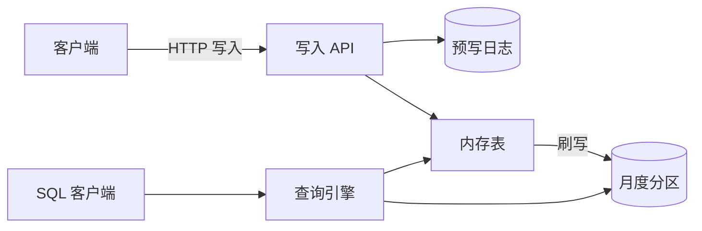

有些事实本身就是形状：数据如何流经服务器，吞吐量如何随版本一路增长，仪表盘长什么样。OINK 用你写在页面里的文本把它们画出来，可能是几行 Mermaid、一段 ECharts 配置，或者一个 TeX 公式，所以每次修改在评审时都是一份可读的 diff，搜索也能找到其中的文字。本章为 Starter 的 Architecture 页面 `content/docs/introduction/architecture.md` 以及旁边的 Overview 页面配图。

## 用文本画图 {#mermaid}

把代码围栏命名为 `mermaid`，然后写出图形。下面这张图展示一次写入如何落到磁盘，以及一次查询如何找到它：

````markdown {title="源码"}

````


不需要任何配置。Mermaid 引擎随主题提供，在读者的浏览器里运行，而且只有含 `mermaid` 代码围栏的页面才会加载它。每张图的角落里有一个按钮，可以在查看器里打开这张图，读者能平移和缩放。[Mermaid](/zh/docs/components/mermaid/) 介绍了时序图、甘特图等其他图形。

## 用数据画图表 {#echarts}

基准测试是一张数字表，画成柱状图后读者理解得更快。`echarts` 代码围栏里写的是 YAML 格式的 ECharts option 对象，数字就留在你的 Markdown 里：

````markdown {title="源码"}
```echarts {height="300px"}
tooltip:
  trigger: axis
xAxis:
  type: category
  data: ['2.0', '2.4', '3.0']
yAxis:
  type: value
  name: 百万点/秒
series:
  - name: 写入速率（8 核）
    type: bar
    data: [1.2, 1.9, 3.4]
```
````

```echarts {height="300px"}
tooltip:
  trigger: axis
xAxis:
  type: category
  data: ['2.0', '2.4', '3.0']
yAxis:
  type: value
  name: 百万点/秒
series:
  - name: 写入速率（8 核）
    type: bar
    data: [1.2, 1.9, 3.4]
```

Hugo 在构建时会检查这些配置，解析失败时给出带行号的告警；图表也会跟随亮色和暗色模式切换。[ECharts](/zh/docs/components/echarts/) 展示了折线图、饼图和组合图表。

## 公式 {#math}

估算服务器规格的读者需要算式。公式用 TeX 书写，在站点构建时由 KaTeX 渲染成 HTML 和 MathML；不过 `$$` 和 `\(…\)` 分隔符需要 Goldmark 的 passthrough 扩展，而 Starter 没有开启它。把它加到 `hugo.yaml` 的 `markup` 块里；Hugo 不会从主题继承 `markup` 设置，所以 OINK 无法替你完成这一步：

```yaml {title="hugo.yaml"}
markup:
  goldmark:
    extensions:
      passthrough:
        enable: true
        delimiters:
          block: [['\[', '\]'], ['$$', '$$']]
          inline: [['\(', '\)']]
```

保留旁边已有的 `renderer`、`parser` 和 `highlight` 键。然后写出估算式：

```markdown {title="源码"}
保留期内的磁盘用量大致为：

$$
S = \frac{N \cdot f \cdot T \cdot b}{c}
$$

其中 \(N\) 为序列数，每条序列每秒写入 \(f\) 次、共写入 \(T\) 秒，\(b\) 为每个原始数据点的字节数，\(c\) 为压缩比，通常约为 10。
```

保留期内的磁盘用量大致为：

$$
S = \frac{N \cdot f \cdot T \cdot b}{c}
$$

其中 \(N\) 为序列数，每条序列每秒写入 \(f\) 次、共写入 \(T\) 秒，\(b\) 为每个原始数据点的字节数，\(c\) 为压缩比，通常约为 10。

单个 `$` 刻意不作为分隔符，所以正文里的“$5”仍然是价格。[第 7 章](/zh/book/07-book/)会给这样的公式编号。

## 带说明的截图 {#images}

只有一个页面用到的截图，应该放在那个页面旁边。把页面改成页面包：将 `architecture.md` 移到 `architecture/index.md`，再把图片放进同一个目录。页面地址不会改变。

```filetree {title="页面包"}
- content/docs/introduction/
  - architecture/
    - index.md
    - index.zh.md
    - dashboard.webp   # 两种语言共用
```

把图片写成普通 Markdown，单独成段，再在它下面紧贴着加一行属性，写上说明文字：

```markdown {title="源码"}

{caption="首次写入后，位于 http://localhost:8086/ui 的内置仪表盘。"}
```

下面是用本站图片套用同样写法的效果：


{caption="带说明的图片：替代文字描述画面，说明文字交代它为什么出现在这里。" width=600 height=300}

主题会把图片尺寸写进页面，加载过程中正文不会跳动。在 `hugo.yaml` 里设置 `params.ui.image_zoom: true`，读者就能点击图片查看原尺寸。要并排对比几个界面，就在 `gallery` 代码围栏里每行写一张图片：

````markdown {title="源码"}
```gallery
 # 亮色模式
 # 暗色模式
```
````

```gallery
 # 亮色模式
 # 暗色模式
```

## 终端录像 {#asciinema}

安装过程看着做更容易跟上，而 [asciinema](https://asciinema.org/) 录像以文本形式保存输出，读者可以随时暂停并复制命令。把 `.cast` 文件放进 `static/`，再在短代码里写上它的路径：

```markdown {title="源码"}

```



这段录像真实记录了在 Debian 上安装 [Pigsty](https://pigsty.io/) 的六分钟全过程，文件约 196 KB。用 `asciinema rec install.cast` 就能录制你自己的录像。播放器随主题提供，并跟随站点的亮色和暗色配色。

## 时间轴上的里程碑 {#timeline}

Overview 页面讲述项目的历史。在定义列表下一行加上 `{.timeline}`，事件就会沿一条线排开，每个事件挨着自己的标记：

```markdown {title="源码"}
2024-03
: **Acme DB 1.0**：单节点服务器，支持 SQL 查询。

2025-02
: **Acme DB 2.0**：月度分区与保留策略。

2026-10
: **Acme DB 3.0**：分层存储，写入速率提升到原来的三倍。
{.timeline}
```

2024-03
: **Acme DB 1.0**：单节点服务器，支持 SQL 查询。

2025-02
: **Acme DB 2.0**：月度分区与保留策略。

2026-10
: **Acme DB 3.0**：分层存储，写入速率提升到原来的三倍。
{.timeline}

条目之间保留一个空行，`{.timeline}` 前面则不要空行；属性行脱离列表时，构建会给出告警。

## 视频、音频及其他 {#more}

内容需要时，下面每一项都有自己的说明页和示例：

- [视频](/zh/docs/components/video/) — 放在页面旁边的 MP4 产品演示，或者一张点击之前不加载任何内容的 YouTube 卡片。
- [音频](/zh/docs/components/audio/) — 用浏览器自带的播放器播放一期播客或一段发音示例。
- [Draw.io](/zh/docs/components/drawio/) — 在 diagrams.net 里编辑、以 SVG 保存的图。
- [PlantUML](/zh/docs/components/plantuml/) — 由内置引擎在浏览器中渲染的 UML 图。
- [Markmap](/zh/docs/components/markmap/) — 把 Markdown 大纲画成思维导图。
- [地图](/zh/docs/components/map/) — 在地图上标出地点，前提是你指定了瓦片服务。
{.cards}

## 加载什么，从哪里加载 {#local-first}

本章用到的每个引擎，包括 Mermaid、ECharts、KaTeX 的样式和 asciinema 播放器，都是主题的一部分，而且页面只加载自身内容用到的那些：一个只有一张图表、没有流程图的页面会下载 ECharts，而不会下载 Mermaid。除非你主动配置，否则不会连接任何其他服务器。地图要等你指定瓦片服务才会工作；YouTube 卡片只有在站点允许、并且读者点击之后，才会连接 YouTube。

## 检查成果 {#checkpoint}

- Architecture 页面显示数据流图和基准测试图表，两者都随亮色和暗色模式切换。
- `hugo.yaml` 里加上 passthrough 配置之后公式才会渲染；在此之前，`$$` 显示为普通文本。
- 截图放在页面包里，显示说明文字，开启缩放后可以点开查看原尺寸。
- Overview 页面在时间轴上显示三个版本。

## 交给 agent {#agent}

```text {num="5-1" caption="提示词：用文本为页面配图。" #eg-agent-media}
为 content/docs/introduction/architecture.md 配图：根据正文描述的写入路径和查询
路径，添加一张 Mermaid 流程图；再用同一页里的基准测试表格生成一张 ECharts 柱状图，
表格本身也保留。如果有页面用到 $$ 公式，按照
https://oink.pgsty.com/zh/docs/components/math/ 的说明在 hugo.yaml 里开启 Goldmark
passthrough。页面加了图片的话，把它改成页面包，给每张图片写上替代文字和说明文字，
最后在亮色和暗色模式下检查效果。
```
