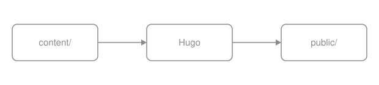
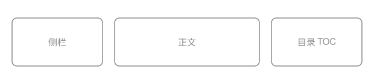
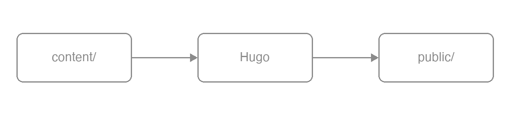

Draw.io uses plain Markdown images. It has no fence or shortcode.
When exporting from Draw.io, select "Include a copy of my diagram". The SVG or PNG then contains an `mxfile` copy.
The theme detects this copy and adds an edit button. Use this integration for diagrams that readers can download and change.
Use an ordinary [image](/docs/components/image/) for diagrams that only need to be viewed.

## Shortest form {#minimal}

To show the edit button, first set `params.drawio.enable: true` and configure
`params.drawio.drawio_server` as shown under [The editor address](#server).
Without this setup, the diagram remains an ordinary image without editing.

Use ordinary image syntax. The filename does not affect detection. `.drawio.svg` is only a naming convention.

```markdown {title="Source"}

{width="620" height="140"}
```


{width="620" height="140"}

An export with an `mxfile` copy is wrapped in a `.drawio` container.
A pencil button appears at the bottom right on hover or keyboard focus. It stays visible on touch devices and in forced-colors mode.
The button opens a full-screen iframe with the site's configured editor.
When image zoom is enabled, Edit and Zoom are separate sibling buttons. Edit does not open the zoom dialog.

## How the copy is detected {#detection}

The runtime checks whether the file contains `mxfile`. It does not check the filename.
A hand-drawn SVG with the same block-image syntax and attribute line has no embedded copy, so it gets no edit button.

```markdown {title="Source"}

{width="620" height="140"}
```


{width="620" height="140"}

## With a caption {#caption}

Draw.io images use the ordinary image render hook. All [image](/docs/components/image/) attributes apply.
Add `caption` to create a captioned figure. The edit button still appears on the image.

```markdown {title="Source"}

{caption="Content, configuration and theme templates flow into Hugo and out as public/" width="620" height="140"}
```


{caption="Content, configuration and theme templates flow into Hugo and out as public/" width="620" height="140"}

## As a numbered figure {#numbered}

Add `{#id num=…}` to create a numbered figure. `xref` can reference it, and it appears in the list of figures.

```markdown {title="Source"}

{#fig_pipeline num="1-1" caption="From content to a static site" width="620" height="140"}
```


{#fig_pipeline num="1-1" caption="From content to a static site" width="620" height="140"}

The complete numbering and cross-reference rules are in
[publishing books](/docs/write/book/).

## SVG or PNG {#svg-or-png}

Both SVG and PNG are recognized. A Draw.io PNG can store the editable copy in a text chunk.
The runtime uses the same detection test.

```markdown {title="Source"}

{width="620" height="140"}
```


{width="620" height="140"}

Prefer SVG for documentation. It scales without quality loss, contains searchable text accessible to screen readers, and has readable diffs.
Use PNG for very complex diagrams or platforms without SVG support. Only PNG supports Hugo image processing; processing an SVG warns and preserves the source.

## What the button does {#editing}

The button performs three actions in this order.

{}

### Lay an overlay over the page {#editing-overlay}

In OINK 1.3.0, the runtime opens a full-screen
`<dialog class="drawioframe">` containing an iframe.
The editor URL keeps the configured `drawio_server` query parameters and fragment,
and sets `embed=1`, `ui=atlas`, `proto=json`, `saveAndEdit=1`, and `noSaveBtn=1`.
The modal includes a localized Close button and contains keyboard focus. Close
it with that button or a background click. Escape closes it while focus is in
the host dialog; the embedded editor handles its own keys. Closing restores
focus to Edit unless another surface has already taken focus.

### Hand the diagram to the editor {#editing-load}

When the editor is ready, the runtime sends the image and its `mxfile` copy to the iframe as a data URL.
This transfer does not use your server.

### Save and write back {#editing-save}

When you save, the editor exports the original format, SVG or PNG. The browser downloads it with the same filename.
The runtime never writes to the repository. Replace the file in `content/` with the download and commit it yourself.

{}

The edit button lets readers download and change a diagram. It does not edit the site online.

## The editor address {#server}

```yaml {title="hugo.yml"}
params:
  drawio:
    enable: true
    drawio_server: https://drawio.internal.example/
```

- `enable: true` without `drawio_server` warns and disables editing.
  The theme does not select a public service.
- The address must be an HTTP(S) URL or local path. Local paths honor the `baseURL` deployment subpath.
  Whitespace, control characters, raw backslashes, protocol-relative URLs (`//host/`), and other schemes warn and disable editing.
- If editing must stay within your organization, deploy a [self-hosted editor](https://github.com/jgraph/docker-drawio) and configure its address.
- The public endpoint `https://embed.diagrams.net/` works. With this endpoint, the reader's diagram is sent to a third-party page.

Both keys are defined in
[Configuration](/docs/customize/config/).

## Output {#outputs}

| Output | Shape |
| --- | --- |
| HTML | A plain `` or `<figure>`; once enabled, the runtime wraps an image that carries a copy in `<div class="drawio">` and adds the button |
| Print | The image prints as usual; this output loads no Draw.io runtime and creates no edit button |
| Markdown | Plain Markdown image syntax |
| RSS | A plain `` with an absolute URL and no button |

All four outputs include the image. Only HTML adds the optional edit button.

## Parameter reference {#reference}

Draw.io has no fence or shortcode parameters. It uses the [Images](/docs/components/image/) attribute line:
`caption`, `width`, `height`, `link`, `#id`, `num`, `command`, and `options`.

Site parameters (`hugo.yml`):

| Parameter | Type | Default | Description |
| --- | --- | --- | --- |
| `params.drawio.enable` | bool | `false` | With it off no script loads and an image is just an image |
| `params.drawio.drawio_server` | string | none | The editor address; required when `enable: true` |
{.fields meta="type default"}

## Limits {#limits}

- The runtime loads only if rendered page content has `.svg` or `.png` candidates.
  It groups matching images by URL and reads each URL once to find `mxfile`.
- Without "Include a copy of my diagram" on export, the image has no edit button.
- Editing needs the editor and never writes to the repository. Offline, images display normally, but the button has no effect.
  Saving downloads a file. You must replace and commit the file manually.
- Exported SVG colors are fixed and do not follow the site's color scheme.
  Use `none` fills and neutral gray lines and text so the image is readable in both modes.

## Related {#related}

- [Images](/docs/components/image/) — captions, numbering, sizing and zoom in full
- [PlantUML](/docs/components/plantuml/) — UML diagrams; see its rendering modes and version requirements
- [Mermaid](/docs/components/mermaid/) — diagrams from text with no server at all
- [Configuration](/docs/customize/config/) — the full definition of `params.drawio.*`
