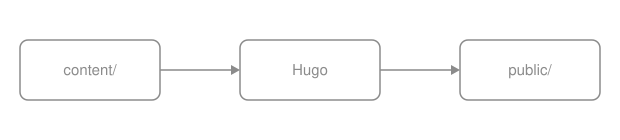
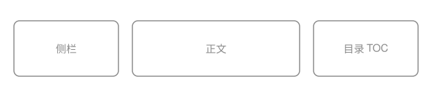
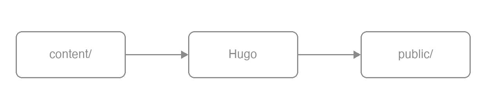

A diagram exported from Draw.io can carry its own source. Put such an export
in a page as an ordinary Markdown image and the theme adds an edit button that
opens it in the Draw.io editor, so a reader or a teammate can change the
diagram and download the result instead of redrawing it from a screenshot.
There is no fence or shortcode: the only requirement is that you tick
"Include a copy of my diagram" when you export the SVG or PNG. A diagram that
only needs to be looked at is an ordinary [image](/docs/components/image/).

## Shortest form {#minimal}

The edit button appears once the site sets `params.drawio.enable: true` and
an editor address in `params.drawio.drawio_server`, as shown under
[The editor address](#server). Until then, every diagram is shown as a plain
image.

Write the diagram like any image. The `.drawio.svg` name is a convention that
helps you find the editable files; the theme does not look at the name.

```markdown {title="Source"}

{width="620" height="140"}
```


{width="620" height="140"}

A pencil button appears at the bottom right of the diagram when the pointer is
over it or keyboard focus reaches it; on touch screens and in forced-colors
mode it is always visible. The button opens the configured editor over the
whole page. When [image zoom](/docs/components/image/#zoom) is also on, Edit
and Zoom are two separate buttons, and Edit never opens the zoom dialog.

## How the copy is detected {#detection}

What decides is the content of the file: an export with an embedded Draw.io
copy gets the button, and any other image does not. This hand-drawn SVG uses
the same syntax and attribute line as the diagram above, but it carries no
copy, so it has no button:

```markdown {title="Source"}

{width="620" height="140"}
```


{width="620" height="140"}

## With a caption {#caption}

A Draw.io diagram is rendered by the ordinary image hook, so every
[image](/docs/components/image/) attribute applies. Add `caption` for a
captioned figure; the edit button stays on the image.

```markdown {title="Source"}

{caption="Content, configuration and theme templates flow into Hugo and out as public/" width="620" height="140"}
```


{caption="Content, configuration and theme templates flow into Hugo and out as public/" width="620" height="140"}

## As a numbered figure {#numbered}

Add `{#id num=…}` to make it a numbered figure that `xref` can refer to and
that appears in the list of figures:

```markdown {title="Source"}

{#fig_pipeline num="1-1" caption="From content to a static site" width="620" height="140"}
```


{#fig_pipeline num="1-1" caption="From content to a static site" width="620" height="140"}

[Publishing books](/docs/write/book/) has the complete numbering and
cross-reference rules.

## SVG or PNG {#svg-or-png}

Both work. A PNG export keeps the editable copy in a text chunk of the image,
and the button appears the same way:

```markdown {title="Source"}

{width="620" height="140"}
```


{width="620" height="140"}

Prefer SVG for documentation: it stays sharp at any size, its labels are real
text that search and screen readers can read, and its diffs are readable in
review. Choose PNG for a very complex diagram or for a platform without SVG
support. Hugo's image processing works only on PNG; processing an SVG warns
and keeps the original file.

## What the button does {#editing}

Edit hands the diagram to the editor and gives the reader a file back;
nothing on the site changes.

{}

### The editor opens over the page {#editing-overlay}

A full-screen dialog opens with the Draw.io editor inside it and a Close
button in the reader's language. Keyboard focus stays inside the dialog.
Close it with that button, by clicking the background, or with Escape while
focus is outside the editor, which handles its own keys. Focus then returns to
the Edit button.

### The diagram goes straight to the editor {#editing-load}

When the editor is ready, the reader's browser hands it the image together
with its embedded copy. The diagram does not pass through your web server.

### Saving downloads a new file {#editing-save}

Save in the editor, and the browser downloads the diagram in its original
format, SVG or PNG, under the original file name. Nothing is written back to
the site: to publish the change, replace the file in `content/` with the
download and commit it.

{}

The button lets readers take a diagram away and change it; it is not an
online editor for the site.

## The editor address {#server}

```yaml {title="hugo.yml"}
params:
  drawio:
    enable: true
    drawio_server: https://drawio.internal.example/
```

- `enable: true` without `drawio_server` warns and leaves editing off. The
  theme never picks a public service for you.
- The address must be an `http(s)` URL or a local path; a local path follows
  the deployment subpath in `baseURL`. Whitespace, control characters,
  backslashes, protocol-relative URLs (`//host/`) and other schemes warn and
  turn editing off.
- Query parameters and a fragment in the address, such as `?lang=en`, are
  kept, and the theme adds Draw.io's embed-mode parameters (`embed=1`,
  `proto=json` and others).
- When diagrams must not leave your organization, run a
  [self-hosted editor](https://github.com/jgraph/docker-drawio) and point the
  address at it.
- The public editor `https://embed.diagrams.net/` works too, but the reader's
  diagram is then opened in a third-party page.

[Configuration](/docs/customize/config/) defines both keys.

## Output {#outputs}

The diagram appears as an ordinary image in print, RSS and the page's
Markdown output; only the HTML page gets the edit button.

## Parameter reference {#reference}

Draw.io has no parameters of its own on the page. The attribute line is the
one from [Images](/docs/components/image/): `caption`, `width`, `height`,
`link`, `#id`, `num`, `command` and `options`.

Site parameters (`hugo.yml`):

| Parameter | Type | Default | Description |
| --- | --- | --- | --- |
| `params.drawio.enable` | bool | `false` | With it off no script loads and an image is just an image |
| `params.drawio.drawio_server` | string | none | The editor address; required when `enable: true` |
{.fields meta="type default"}

## Limits {#limits}

- The edit check runs only on pages with PNG or SVG images, and it reads each
  distinct image address once to look for an embedded copy.
- An export made without "Include a copy of my diagram" has no copy, so it
  gets no button.
- Editing needs the editor to be reachable. Offline, diagrams display
  normally but the editor cannot load.
- Saving only downloads a file; replacing it in the repository and committing
  is up to you.
- An exported SVG has fixed colors that do not follow light and dark mode.
  Use `none` fills and neutral gray lines and text, as the diagrams on this
  page do, so that the diagram reads well in both.

## Related {#related}

- [Images](/docs/components/image/) — captions, numbering, sizing and zoom in full
- [PlantUML](/docs/components/plantuml/) — UML diagrams; see its rendering modes and version requirements
- [Mermaid](/docs/components/mermaid/) — diagrams from text with no server at all
- [Configuration](/docs/customize/config/) — the full definition of `params.drawio.*`
