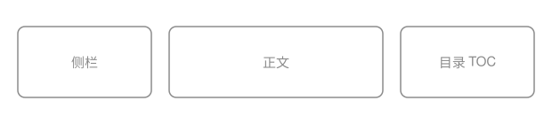
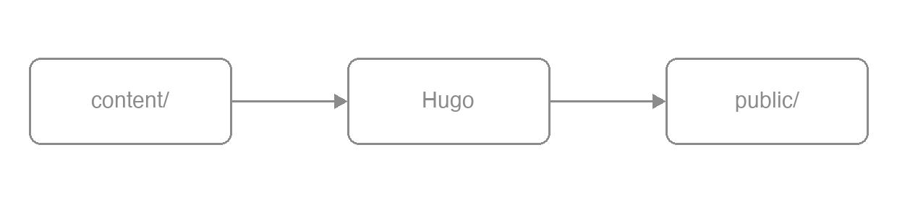

从 Draw.io 导出的图可以带着自己的源文件。把这样的导出文件当作普通 Markdown 图片放进页面，主题会给它加一个编辑按钮，在 Draw.io 编辑器里打开这张图；读者或同事可以直接修改并下载结果，不必对着截图重画。没有围栏，也没有 shortcode，唯一的要求是导出 SVG 或 PNG 时勾选「Include a copy of my diagram」。只供查看的图按普通[图片](/zh/docs/components/image/)处理即可。

## 最简例子 {#minimal}

站点设置 `params.drawio.enable: true`，并在 `params.drawio.drawio_server` 里填好编辑器地址之后，编辑按钮才会出现，写法见[编辑器地址](#server)。在此之前，所有图都按普通图片显示。

写法与普通图片相同。`.drawio.svg` 这个文件名只是方便你找出可编辑文件的惯例，主题并不看文件名。

```markdown {title="源码"}

{width="620" height="140"}
```


{width="620" height="140"}

鼠标悬停在图上或键盘焦点移到图上时，右下角会出现一个铅笔按钮；在触屏设备与强制颜色模式下，按钮始终可见。点击按钮，站点配置的编辑器会铺满整个页面打开。同时开启了[图片缩放](/zh/docs/components/image/#zoom)时，编辑与缩放是两个独立的按钮，点编辑不会打开缩放对话框。

## 副本检测 {#detection}

起决定作用的是文件内容：嵌有 Draw.io 副本的导出文件会得到按钮，其它图片不会。下面这张手绘 SVG 与上面那张的写法、属性行完全相同，但它没有副本，所以没有按钮：

```markdown {title="源码"}

{width="620" height="140"}
```


{width="620" height="140"}

## 带图注 {#caption}

Draw.io 图由普通的图片渲染钩子处理，[图片](/zh/docs/components/image/)的所有属性都适用。加上 `caption` 得到带图注的 figure，编辑按钮仍在图上。

```markdown {title="源码"}

{caption="内容、配置与主题模板汇进 Hugo，产出 public/ 目录" width="620" height="140"}
```


{caption="内容、配置与主题模板汇进 Hugo，产出 public/ 目录" width="620" height="140"}

## 编号成书里的图 {#numbered}

加上 `{#id num=…}`，它就成为一张编号图，可以被 `xref` 引用，也会出现在图目录里：

```markdown {title="源码"}

{#fig_pipeline num="1-1" caption="从内容到静态站点" width="620" height="140"}
```


{#fig_pipeline num="1-1" caption="从内容到静态站点" width="620" height="140"}

编号与交叉引用的完整规则见[书籍出版](/zh/docs/write/book/)。

## SVG 还是 PNG {#svg-or-png}

两种都可以。PNG 导出把可编辑副本存放在图片的文本块里，按钮同样会出现：

```markdown {title="源码"}

{width="620" height="140"}
```


{width="620" height="140"}

文档里优先用 SVG：放大缩小都清晰，图中文字是真实文本，搜索与读屏器都能读取，评审时 diff 也看得懂。图特别复杂、或者目标平台不支持 SVG 时再用 PNG。Hugo 的图片处理只对 PNG 生效；对 SVG 做处理会告警并保留原文件。

## 编辑流程 {#editing}

编辑按钮把图交给编辑器，再把一个文件交还给读者，站点上的任何东西都不会改变。

{}

### 编辑器在页面上方打开 {#editing-overlay}

页面上打开一个全屏对话框，里面是 Draw.io 编辑器，另有一个按读者语言显示的关闭按钮。键盘焦点被限制在对话框内。点关闭按钮、点击背景，或者在焦点不在编辑器内时按 Escape，都能关闭它；编辑器内部的按键由编辑器自己处理。关闭后焦点回到编辑按钮。

### 图直接送进编辑器 {#editing-load}

编辑器就绪后，读者的浏览器把这张图连同嵌入的副本一起交给编辑器，图不经过你的网站服务器。

### 保存即下载新文件 {#editing-save}

在编辑器里保存，浏览器会按原来的格式（SVG 或 PNG）、用原来的文件名下载这张图。站点上的文件不会被改写：要发布改动，用下载的文件替换 `content/` 里的那一份，再提交。

{}

这个按钮让读者把图带走修改，并不是站点的在线编辑功能。

## 编辑器地址 {#server}

```yaml {title="hugo.yml"}
params:
  drawio:
    enable: true
    drawio_server: https://drawio.internal.example/
```

- 只写 `enable: true` 而没有 `drawio_server` 时会告警，编辑功能保持关闭。主题从不替你选择公共服务。
- 地址必须是 `http(s)` URL 或本地路径；本地路径会跟随 `baseURL` 里的部署子路径。含空白、控制字符、反斜杠，或者写成协议相对 URL（`//host/`）、使用其它 scheme 时，会告警并关闭编辑功能。
- 地址里已有的查询参数与片段（例如 `?lang=en`）会保留，主题再加上 Draw.io 嵌入模式所需的参数（`embed=1`、`proto=json` 等）。
- 图不能离开组织内部时，部署一份[自托管编辑器](https://github.com/jgraph/docker-drawio)，把地址指向它。
- 也可以用公共编辑器 `https://embed.diagrams.net/`，但读者的图会在第三方页面里打开。

这两个键的定义见[配置总览](/zh/docs/customize/config/)。

## 输出形态 {#outputs}

在打印、RSS 与页面的 Markdown 输出里，这张图就是一张普通图片；只有 HTML 页面才有编辑按钮。

## 参数参考 {#reference}

Draw.io 在页面上没有专属参数，属性行沿用[图片](/zh/docs/components/image/)那一套：`caption`、`width`、`height`、`link`、`#id`、`num`、`command` 与 `options`。

站点参数（`hugo.yml`）：

| 参数 | 类型 | 默认 | 说明 |
| --- | --- | --- | --- |
| `params.drawio.enable` | bool | `false` | 关闭时不加载任何脚本，图片就是图片 |
| `params.drawio.drawio_server` | string | 无 | 编辑器地址；`enable: true` 时必填 |
{.fields meta="type default"}

## 限制与常见问题 {#limits}

- 只有含 PNG 或 SVG 图片的页面才会检查可编辑副本，每个不同的图片地址只读取一次。
- 导出时没有勾选「Include a copy of my diagram」的文件不带副本，也就没有按钮。
- 编辑需要能访问编辑器。离线时图片照常显示，但编辑器无法加载。
- 保存只是下载一个文件，替换仓库里的文件并提交要你自己完成。
- 导出的 SVG 颜色是固定的，不会跟随深浅色。像本页这两张图一样，把填充设为 `none`、线条与文字用中性灰，两种模式下都清晰可读。

## 相关 {#related}

- [图片](/zh/docs/components/image/) — 图注、编号、尺寸、缩放的完整规则
- [PlantUML](/zh/docs/components/plantuml/) — UML 图表；渲染模式与版本要求见指南
- [Mermaid](/zh/docs/components/mermaid/) — 不需要任何服务的文本画图
- [配置总览](/zh/docs/customize/config/) — `params.drawio.*` 的完整定义
