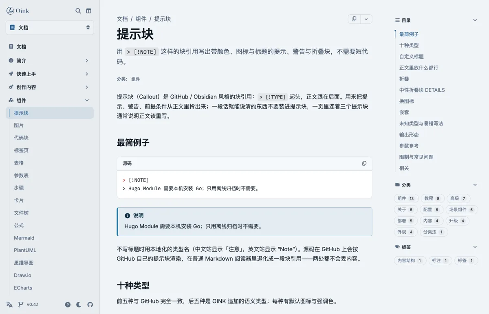
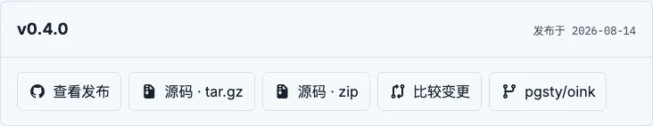

Screenshots and diagrams go in with ordinary Markdown, ``,
so the same source still shows the image on GitHub or in any editor. When an
image needs more, such as a caption, a display size, a figure number for a
book or a resized copy made at build time, put it in its own paragraph and add
one `{…}` attribute line under it. There is no image shortcode to learn.

## Shortest form {#minimal}

```markdown {title="Source"}

```


The image file sits next to this page's `index.md`, which makes the folder a
page bundle. The theme reads the image's size and writes `width` and `height`
into the page, so the text does not jump while it loads, and every image is
lazy-loaded. Always write alt text, because screen readers and search engines
rely on it; leave it empty only for a decorative image, which also never zooms.

## Where images come from {#sources}

Put each image where it is easiest to maintain and use the matching path form:

| Placement | How it is written | Suited to |
| --- | --- | --- |
| Beside the page (a bundle: `index.md` plus the image) | `` | A screenshot only this page uses; it travels with the page and is shared by translations |
| Current section bundle (`_index.md` and its resources) | `` | Images belonging to a section; use the resource path relative to that section |
| Global resource `assets/images/…` | `` | Images several pages share, especially ones needing processing (resize / crop) |
| Static directory `static/images/…` | `` | Large images and downloads that need no processing; supply `width`/`height` where the theme cannot measure them |
| Remote URL | `` | Rare: nothing is downloaded at build time and nothing can be processed |

A relative path is looked up as a page resource, then a resource of the
current section, then a global resource. When none matches, the path is
published as a static path; the theme does not check whether static paths or
remote URLs exist, so a typo shows up as a broken image in the browser. If an
image asks for processing but no processable resource is found, the build
warns and publishes the image unprocessed.

Alt text written in Markdown always wins over the resource's metadata,
including an empty alt that marks a decorative image. A resource's
`params.alt` must be a string; any other value warns and is ignored.

## Inline versus block {#inline-vs-block}

An image inside a line of text is inline: it renders as a single `` and
takes no attributes. An image in a paragraph of its own is a block image, and
only a block image can carry an attribute line.

```markdown {title="Source"}
This little one  sits inside a sentence — an inline image.


{width="100" height="64"}
```

This image  is inside a sentence, so it is inline.


{width="100" height="64"}

An inline image shows at its own size, 50×32 here. An SVG without an intrinsic
size would stretch to the full column width inline, so place SVGs as block
images with an explicit `width` and `height`.

> [!NOTE]
> Block images need `markup.goldmark.parser.wrapStandAloneImageWithinParagraph: false`
> in the site's own `hugo.yml`; see [the Goldmark prerequisites](/docs/customize/config/#goldmark).
> Without it, Goldmark wraps every standalone image in `<p>` and prints the
> attribute line as text.

## Captions {#caption}

`caption="…"` turns the image into a `<figure>` with a `<figcaption>`.
Captions are plain text; Markdown in them is not rendered.

```markdown {title="Source"}

{caption="The release card uses the page's release_url and date"}
```


{caption="The release card uses the page's release_url and date"}

The `"title"` part of the Markdown image stays a hover tooltip and never
becomes the caption.

## Size {#size}

`width` and `height` take positive integers and override the size the theme
measured. Use them to reserve space for a static or remote image, which the
theme cannot measure, or to show a large image smaller. The browser does the
scaling; the file itself is unchanged.

```markdown {title="Source"}

{width="450" height="300" caption="A 900×600 illustration from static/images/ shown at half size"}
```


{width="450" height="300" caption="A 900×600 illustration from static/images/ shown at half size"}

## Processed images {#processing}

To publish a smaller or cropped copy instead of the original file, let Hugo
process the image at build time. Give both `command` (`Fit`, `Resize`, `Fill`
or `Crop`) and `options` in Hugo's image-processing syntax. The page then links
the processed copy, and when zoom is on, the dialog still opens the original.

```markdown {title="Source"}

{command="Fit" options="300x150" caption="Fit 300x150: scaled to fit inside a 300×150 box"}


{command="Fill" options="300x150 Left" caption="Fill 300x150 Left: fills the box, cropped from the left"}
```


{command="Fit" options="300x150" caption="Fit 300x150: scaled to fit inside a 300×150 box"}


{command="Fill" options="300x150 Left" caption="Fill 300x150 Left: fills the box, cropped from the left"}

Only page and global resources can be processed. A `command` on a static path,
a remote URL or an SVG warns and publishes the image unprocessed. Anchors,
quality and format conversion, such as `300x150 webp q80`, are described in
[Hugo image processing](https://gohugo.io/content-management/image-processing/).

## Linked images {#link}

There are two ways to make an image clickable, depending on whether it has a
caption:

- Without a caption, wrap the image in a Markdown link: `[](href)`.
- To make a captioned figure clickable as a whole, add `link="…"` to the
  attribute line, which then also needs `caption` or `num`.

```markdown {title="Source"}
[](/docs/about/features/)


{caption="Click the image for the releases and downloads guide" link="/docs/write/releases/"}
```

[](/docs/about/features/)


{caption="Click the image for the releases and downloads guide" link="/docs/write/releases/"}

A linked image never zooms, because a click follows the link. A `link=`
without a caption or number warns and is dropped, and the warning suggests the
`[](…)` form.

## Numbered figures {#numbered}

Books and long manuals refer to figures by number. Add `num` to the attribute
line, and optionally an `#id`. You write the number yourself as a string such
as `2-1` or `3.4`, because the theme never counts; the caption then starts
with a localized "Figure 2-1", and the ID defaults to `fig-<num>`. Refer to
the figure with an ordinary link such as `[Figure 2-1](#fig-2-1)` or with
`xref`; [Books](/docs/write/book/) covers the whole-book list of figures.

```markdown {title="Source"}

{#fig-release num="2-1" caption="The release card: version, date and assets"}

See [Figure 2-1](#fig-release).
```


{#fig-release num="2-1" caption="The release card: version, date and assets"}

See [Figure 2-1](#fig-release).

A numbered figure can also be processed (`num` with `command`) and can carry a
`link`.

## Zoom {#zoom}

Zoom lets readers open a screenshot at full size without leaving the page.
It is off by default. Turn it on for the whole site with
`params.ui.image_zoom`; `image_zoom` in a page's front matter overrides the
site setting for that page, in either direction:

```yaml {title="hugo.yml"}
params:
  ui:
    image_zoom: true
```

```yaml {title="One page's front matter: off for this page only"}
image_zoom: false
```

With zoom on, block images, figures and gallery images that have alt text
become buttons that open the full image in a native `<dialog>`; <kbd>Esc</kbd>
closes it and returns focus to the image. This page turns zoom on in its front
matter, so you can click any image above. The button's label exists only for
screen readers, so copying the article copies the images and captions and no
button text.

Inline images, decorative images with empty alt text, linked images and
images marked `data-no-zoom` never zoom. The zoom script loads only on pages
that have an image that can zoom.

```markdown {title="Source: a decorative image does not zoom"}

{width="150" height="75"}
```


{width="150" height="75"}

## Light and dark images {#dark-mode}

There is no setting that swaps an image by color scheme. When a screenshot
needs a light and a dark version, give each one a `class` and hide the wrong
one in site CSS. The theme sets `data-bs-theme` on `html`, so these selectors
show exactly one of the two:

```markdown {title="Source"}

{class="only-light"}


{class="only-dark"}
```

```css {title="assets/css/project.css"}
html[data-bs-theme="dark"] .only-light,
html:not([data-bs-theme="dark"]) .only-dark { display: none; }
```

Replace `sidebar-light.webp` and `sidebar-dark.webp` with your own images.

## Output {#outputs}

Print shows images and figures as on the web, without the zoom buttons, and
RSS rewrites each image `src` to an absolute URL. The page's Markdown output
keeps `` and the attribute line as you wrote them.

## Parameter reference {#reference}

The attribute line `{…}`, on the line right after a block image:

| Parameter | Type | Default | Description |
| --- | --- | --- | --- |
| `caption` | plain text | — | Its presence makes a figure; not parsed as Markdown |
| `#id` | identifier | `fig-<num>` when `num` is set | `[A-Za-z][A-Za-z0-9_.:-]*`; the anchor and the Book target ID |
| `num` | string | — | `[0-9A-Za-z.-]+`; registers a Book figure target and prefixes the caption with "Figure N." |
| `width` / `height` | positive integer | the resource's intrinsic size | Overrides the size; static and remote images use it to avoid layout shift |
| `command` | enum | — | `Fit`, `Resize`, `Fill`, `Crop`; must accompany `options`; page and global resources only |
| `options` | string | — | Hugo image processing options such as `600x300`, `300x150 Left`, `800x webp q80` |
| `link` | URL | — | Wraps the figure in a link; requires `caption` or `num`; a linked image does not zoom |
| `class` | class list | — | Passed through for the site's CSS |
| `data-*` / `aria-*` | string | — | Passed through |
{.fields meta="type default"}

`style`, `on*`, `alt`, `title`, `src` and any other key on the attribute line
warn and are ignored. Alt text, title and source belong in the Markdown image
itself.

## Limits {#limits}

- Captions and every other string parameter are plain text; put a longer
  explanation in a paragraph under the image.
- `title` is not a caption: the `c` in `` is a hover tooltip.
- Only resources can be processed, so move an image that needs processing from
  `static/` into the page bundle or `assets/`.
- Remote images are never downloaded at build time.
- Zoom has no drag, pan or previous / next control; show a set of related
  images as a [gallery](/docs/components/gallery/).

## Related {#related}

- [Gallery](/docs/components/gallery/) — a set of images sharing one zoom dialog
- [Books](/docs/write/book/) — the list of figures and `xref` cross-references
- [Brand and appearance](/docs/customize/brand/) — where the site logo and favicon go
- [Cards](/docs/components/cards/) — images on cards
