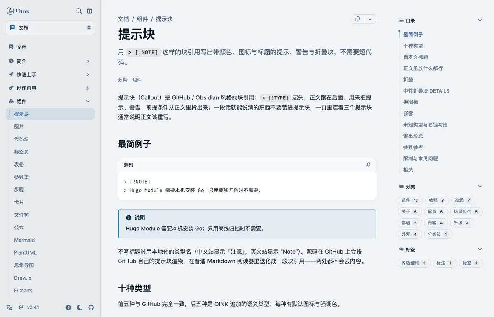
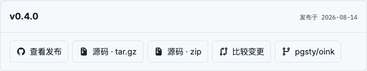

Write images with Markdown's `` syntax.
For an image in its own paragraph, add a `{…}` attribute line to enable captions, zoom, numbering, or Hugo processing.
The theme has no image shortcode.

## Shortest form {#minimal}

```markdown {title="Source"}

```


This image is in the page's directory, which forms a page bundle.
The theme reads its intrinsic dimensions and writes `width`/`height` to prevent layout changes during loading. All images use lazy loading.
You should always write alternative text for screen readers and search engines. Empty alt text marks a decorative image, which is excluded from zoom.

## Where images come from {#sources}

Sources resolve in this order. Use the corresponding path form for each location:

| Placement | How it is written | Suited to |
| --- | --- | --- |
| Beside the page (a bundle: `index.md` plus the image) | `` | A screenshot only this page uses; it travels with the page and is shared by translations |
| Current section bundle (`_index.md` and its resources) | `` | Images belonging to a section; use the resource path relative to that section |
| Global resource `assets/images/…` | `` | Images several pages share, especially ones needing processing (resize / crop) |
| Static directory `static/images/…` | `` | Large images and downloads that need no processing; supply `width`/`height` where the theme cannot measure them |
| Remote URL | `` | Rare: nothing is downloaded at build time and nothing can be processed |

The theme resolves relative paths as page resources, current-section resources, then global resources.
If no resource matches, it emits a static path. It does not check whether static paths or remote URLs exist.
If image processing cannot find a processable resource, ordinary previews warn and preserve the unprocessed image.
Review the warning and rendered fallback before publication.

Markdown alternative text takes precedence over resource metadata, including explicitly empty alt text for decorative images.
Resource `params.alt` must be a string. Invalid metadata warns and is ignored, preserving the authored alt text.
Review the warning and rendered fallback before publication.

## Inline versus block {#inline-vs-block}

An image within a text line is inline. It renders as one `` and accepts no attributes.
An image in its own paragraph is a block image and accepts an attribute line.

```markdown {title="Source"}
This little one  sits inside a sentence — an inline image.


{width="100" height="64"}
```

This image  is inside a sentence, so it is inline.


{width="100" height="64"}

Inline images display at their intrinsic dimensions: 50×32 in this example.
An inline SVG without intrinsic dimensions fills the container width. Use a block image with explicit `width`/`height` for SVG.

> [!NOTE]
> Block images need `markup.goldmark.parser.wrapStandAloneImageWithinParagraph: false`.
> This site has that setting. See [Configuration](/docs/customize/config/).
> Without it, Goldmark wraps standalone images in `<p>` and treats attribute lines as prose.

## Captions {#caption}

`caption="…"` creates a `<figure>` with a `<figcaption>`. Captions are plain text and are not parsed as Markdown.

```markdown {title="Source"}

{caption="The release card uses the page's release_url and date"}
```


{caption="The release card uses the page's release_url and date"}

A Markdown `"title"` is a hover tooltip. It never becomes a caption.

## Size {#size}

`width`/`height` take positive integers and override the resource dimensions.
For static or remote images, they reserve space to prevent layout changes. They can also display a large image at a smaller size.
The browser scales the image. The file stays unchanged.

```markdown {title="Source"}

{width="450" height="300" caption="A 900×600 illustration from static/images/ shown at half size"}
```


{width="450" height="300" caption="A 900×600 illustration from static/images/ shown at half size"}

## Processed images {#processing}

Hugo can process page and global resources at build time. Provide both `command` and `options`.
Commands are `Fit`, `Resize`, `Fill`, or `Crop`. Options use Hugo's image-processing syntax.
The rendered `src` points to the derivative. With zoom enabled, the dialog opens the original.

```markdown {title="Source"}

{command="Fit" options="300x150" caption="Fit 300x150: scaled to fit inside a 300×150 box"}


{command="Fill" options="300x150 Left" caption="Fill 300x150 Left: fills the box, cropped from the left"}
```


{command="Fit" options="300x150" caption="Fit 300x150: scaled to fit inside a 300×150 box"}


{command="Fill" options="300x150 Left" caption="Fill 300x150 Left: fills the box, cropped from the left"}

Static paths, remote URLs, and SVG do not support processing.
Using `command` for these sources warns and preserves the unprocessed image.
[Hugo image processing](https://gohugo.io/content-management/image-processing/) documents anchors, quality, and format conversion, such as `300x150 webp q80`.

## Linked images {#link}
Two forms, for different purposes:

- No caption, and the image itself is the link: wrap it in a Markdown link, `[](href)`.
- A captioned figure that is clickable as a whole: add `link="…"` to the attribute line (which requires `caption` or `num`).

```markdown {title="Source"}
[](/docs/about/features/)


{caption="Click the image for the releases and downloads guide" link="/docs/write/releases/"}
```

[](/docs/about/features/)


{caption="Click the image for the releases and downloads guide" link="/docs/write/releases/"}

Linked images never zoom. Using `link=` without a caption warns and removes the link, recommending `[](…)`.

## Numbered figures {#numbered}

For books or long manuals, add `num` to the attribute line, with an optional `#id`.
The author writes the number as a string, such as `2-1` or `3.4`. The theme never counts automatically.
The caption receives a localized "Figure 2-1" prefix. `#id` defaults to `fig-<num>`.
Reference it with `[Figure 2-1](#fig-2-1)` or `xref`. See [Books](/docs/write/book/) for the whole-book figure list.

```markdown {title="Source"}

{#fig-release num="2-1" caption="The release card: version, date and assets"}

See [Figure 2-1](#fig-release).
```


{#fig-release num="2-1" caption="The release card: version, date and assets"}

See [Figure 2-1](#fig-release).

A numbered figure can be a processed image at the same time (`num` plus
`command`), and can carry a `link`.

## Zoom {#zoom}

Image zoom is off by default. When enabled, block images, figures, and gallery images with alt text become clickable buttons.
They open the full image in a native `<dialog>`. Esc closes it and restores the previous focus.
This page enables zoom in front matter, so every image above is clickable.

Since OINK 1.1, the button's accessible name includes the preview action and image description.
Copied articles receive no helper text. Copied HTML keeps images and authored captions for rich-text editors.
In v1.0.0, a hidden preview label can appear after pasting. Until you upgrade, use `image_zoom: false` and rebuild to avoid it.

```yaml {title="hugo.yml"}
params:
  ui:
    image_zoom: true
```

```yaml {title="One page's front matter: off for this page only"}
image_zoom: false
```

Inline images, decorative images with empty alt text, linked images, and images with `data-no-zoom` never zoom.
The runtime loads only if the page has an eligible image. Print, Markdown, and RSS have no dialog.

```markdown {title="Source: a decorative image does not zoom"}

{width="150" height="75"}
```


{width="150" height="75"}

## Light and dark images {#dark-mode}

The theme has no parameter to switch images by color scheme.
If you need two images, give each a `class`. Use `[data-bs-theme="dark"]` in site CSS to display the image for each scheme:

```markdown {title="Source"}

{class="only-light"}


{class="only-dark"}
```

```scss {title="assets/scss/_styles_project.scss"}
html[data-bs-theme="dark"] .only-light,
html:not([data-bs-theme="dark"]) .only-dark { display: none; }
```

Replace `sidebar-light.webp` and `sidebar-dark.webp` with your images.
The theme sets `data-bs-theme` on `html`. These selectors display only the matching image.
`class` passes through for site CSS.

## Output {#outputs}

| Output | What appears |
| --- | --- |
| HTML | Inline ``; block ``; with a caption or number, `<figure class="td-figure">` plus `<figcaption>`; a zoom candidate carries `data-td-image-zoom` |
| Print | As HTML, with the zoom controls removed |
| Markdown | `` and the attribute line as they stand |
| RSS | The image `src` becomes absolute; no zoom |

## Parameter reference {#reference}

The attribute line `{…}` (the line immediately after a block image):

| Parameter | Type | Default | Description |
| --- | --- | --- | --- |
| `caption` | plain text | — | Its presence makes a figure; not parsed as Markdown |
| `#id` | identifier | `fig-<num>` when `num` is set | `[A-Za-z][A-Za-z0-9_.:-]*`; the anchor and the Book target ID |
| `num` | string | — | `[0-9A-Za-z.-]+`; registers a Book figure target and prefixes the caption with "Figure N." |
| `width` / `height` | positive integer | the resource's intrinsic size | Overrides the size; static and remote images use it to avoid layout shift |
| `command` | enum | — | `Fit`, `Resize`, `Fill`, `Crop`; must accompany `options`; page and global resources only |
| `options` | string | — | Hugo image processing options such as `600x300`, `300x150 Left`, `800x webp q80` |
| `link` | URL | — | Wraps the figure in a link; requires `caption` or `num`; a linked image does not zoom |
| `class` | class list | — | Passed through for the site's CSS |
| `data-*` / `aria-*` | string | — | Passed through |
{.fields meta="type default"}

`style`, `on*`, `alt`, `title`, `src`, and unsupported attribute-line keys warn and are ignored.
Write alt, title, and src in the Markdown image itself.

## Limits {#limits}

- Captions do not support Markdown. Public string parameters are plain text. Put detailed explanations in a paragraph below the image.
- `title` is not a caption. The `c` in `` is a hover tooltip.
- Only resources support processing. Move images that need processing from `static/` to the page bundle or `assets/`.
- Remote images are never downloaded at build time.
- Zoom has no drag, pan, or previous / next controls. Use a [gallery](/docs/components/gallery/) for related images.

## Related {#related}

- [Gallery](/docs/components/gallery/) — a set of images sharing one zoom dialog
- [Books](/docs/write/book/) — the list of figures and `xref` cross-references
- [Brand and appearance](/docs/customize/brand/) — where the site logo and favicon go
- [Cards](/docs/components/cards/) — images on cards
