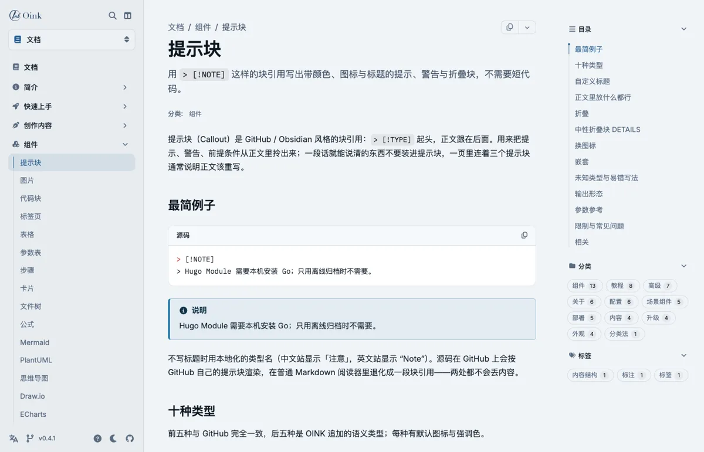
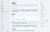
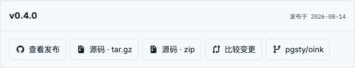

截图和示意图用普通 Markdown 插入：``，同一份源码在 GitHub 或任何编辑器里照样能看到图。图片需要更多东西时，比如图注、显示尺寸、书籍里的图号，或者构建期生成的缩小版，就让它独立成段，在下一行加一行 `{…}` 属性。主题没有图片 shortcode，不用额外学一套语法。

## 最简例子 {#minimal}

```markdown {title="源码"}

```


图片文件与本页的 `index.md` 放在同一目录，这个目录因此构成一个页面包。主题读出图片尺寸，把 `width` 与 `height` 写进页面，图片加载时正文不会跳动；所有图片都懒加载。替代文字请始终填写，屏幕阅读器和搜索引擎都依赖它；只有装饰性图片才留空，这类图片也不参与缩放。

## 图片来源 {#sources}

图片放在哪里方便维护就放在哪里，然后用对应的路径写法：

| 放法 | 源码里怎么写 | 适合 |
| --- | --- | --- |
| 与页面同目录（页面包 `index.md` + 图片） | `` | 只有这一页用的截图；随页面一起移动、翻译共用 |
| 当前分区的页面包（`_index.md` 及其资源） | `` | 分区内的图片；路径相对于该分区的资源目录 |
| 全局资源 `assets/images/…` | `` | 多页共用、还要做处理（缩放 / 裁切）的图 |
| 静态目录 `static/images/…` | `` | 不需要处理的大图、下载物；主题拿不到尺寸时可以用 `width`/`height` 补 |
| 远程 URL | `` | 少用：构建期不会下载，也不能处理 |
{.wide}

相对路径依次按页面资源、当前分区资源、全局资源查找，都找不到时按静态路径发布。主题不检查静态路径和远程 URL 是否存在，路径写错时浏览器里会出现一张破图。要求处理（`command=`）的图片如果找不到可处理的资源，构建会告警，并发布未经处理的原图。

Markdown 里写的替代文字永远优先于资源的元数据，表示装饰图的空 alt 也一样。资源的 `params.alt` 必须是字符串，其它类型的值会告警并被忽略。

## 行内与块级 {#inline-vs-block}

夹在一行文字中间的是行内图片，只渲染为一个 ``，不能带属性；独立成段的是块级图片，只有块级图片可以带属性行。

```markdown {title="源码"}
这一枚小图  夹在句子里，是行内图片。


{width="100" height="64"}
```

这一枚小图  夹在句子里，是行内图片。


{width="100" height="64"}

行内图片按自身尺寸显示，这里是 50×32。没有固有尺寸的 SVG 放在行内会被拉伸到整栏宽度，所以 SVG 应当作为块级图片，并写明 `width` 与 `height`。

> [!NOTE]
> 块级图片依赖站点自己的 `hugo.yml` 中设置 `markup.goldmark.parser.wrapStandAloneImageWithinParagraph: false`，见 [Goldmark 前置配置](/zh/docs/customize/config/#goldmark)。缺少这一项时，Goldmark 会把每张独立图片包进 `<p>`，属性行也会作为正文文字显示出来。

## 图注 {#caption}

`caption="…"` 让图片渲染为带 `<figcaption>` 的 `<figure>`。图注是纯文本，不渲染其中的 Markdown。

```markdown {title="源码"}

{caption="发布卡片使用页面的 release_url 与 date"}
```


{caption="发布卡片使用页面的 release_url 与 date"}

Markdown 图片里的 `"标题"` 仍是鼠标悬停提示，不会变成图注。

## 尺寸 {#size}

`width` 与 `height` 取正整数，覆盖主题读出的尺寸。静态图片和远程图片主题量不到尺寸，可以用它们预留位置；也可以用它们把大图缩小显示。缩放由浏览器完成，文件本身不变。

```markdown {title="源码"}

{width="450" height="300" caption="static/images/ 里的 900×600 插画按一半显示"}
```


{width="450" height="300" caption="static/images/ 里的 900×600 插画按一半显示"}

## 处理型图片 {#processing}

想发布缩小或裁切后的副本而不是原文件时，让 Hugo 在构建期处理图片。`command`（`Fit`、`Resize`、`Fill` 或 `Crop`）与 `options`（Hugo 的图片处理语法）必须同时给出。页面引用的是处理后的副本；开启缩放时，对话框打开的仍是原图。

```markdown {title="源码"}

{command="Fit" options="300x150" caption="Fit 300x150：按比例装进 300×150 的框"}


{command="Fill" options="300x150 Left" caption="Fill 300x150 Left：填满框，从左侧裁"}
```


{command="Fit" options="300x150" caption="Fit 300x150：按比例装进 300×150 的框"}


{command="Fill" options="300x150 Left" caption="Fill 300x150 Left：填满框，从左侧裁"}

只有页面资源和全局资源能处理。对静态路径、远程 URL 或 SVG 写 `command` 会告警，并发布未处理的原图。锚点、质量、格式转换等选项（如 `300x150 webp q80`）见 [Hugo 图片处理](https://gohugo.io/content-management/image-processing/)。

## 链接图片 {#link}

让图片可点击有两种写法，取决于有没有图注：

- 没有图注时，用 Markdown 链接把图包起来：`[](href)`。
- 要让带图注的 figure 整体可点，在属性行加 `link="…"`，此时必须同时有 `caption` 或 `num`。

```markdown {title="源码"}
[](/zh/docs/about/features/)


{caption="点击图片查看发布与下载页的说明" link="/zh/docs/write/releases/"}
```

[](/zh/docs/about/features/)


{caption="点击图片查看发布与下载页的说明" link="/zh/docs/write/releases/"}

带链接的图片不参与缩放，因为点击会跳转。没有图注也没有编号却写了 `link=` 时，构建告警并丢弃链接，提示改用 `[](…)`。

## 编号图 {#numbered}

书籍和长篇手册按编号引用插图。在属性行加 `num`，可以再加一个 `#id`。编号由你自己写成字符串，如 `2-1`、`3.4`，主题从不自动计数；图注前会加上本地化的「图 2-1」，ID 缺省为 `fig-<num>`。正文用普通链接 `[图 2-1](#fig-2-1)` 或 `xref` 引用它；全书的图目录见[书籍出版](/zh/docs/write/book/)。

```markdown {title="源码"}

{#fig-release num="2-1" caption="发布卡片：版本、日期与资产"}

见[图 2-1](#fig-release)。
```


{#fig-release num="2-1" caption="发布卡片：版本、日期与资产"}

见[图 2-1](#fig-release)。

编号图同时也可以是处理型图片（`num` 加 `command`），也可以带 `link`。

## 缩放 {#zoom}

缩放让读者不离开页面就能查看截图原图。它默认关闭：用 `params.ui.image_zoom` 为整个站点开启；页面 front matter 里的 `image_zoom` 会覆盖站点设置，开、关两个方向都可以：

```yaml {title="hugo.yml"}
params:
  ui:
    image_zoom: true
```

```yaml {title="某一页的 front matter：只关这一页"}
image_zoom: false
```

开启后，带替代文字的块级图片、figure 和画廊图片都会变成按钮，在原生 `<dialog>` 中打开原图；按 <kbd>Esc</kbd> 关闭，焦点回到原来的图片。本页在 front matter 中开启了缩放，上面的图都可以点开。按钮的说明文字只提供给屏幕阅读器，复制文章时只会复制图片和图注，不会带上按钮文字。

行内图片、替代文字为空的装饰图、带链接的图片，以及标记了 `data-no-zoom` 的图片都不缩放。只有页面上存在可缩放的图片时，缩放脚本才会加载。

```markdown {title="源码：装饰图不缩放"}

{width="150" height="75"}
```


{width="150" height="75"}

## 深浅色图片 {#dark-mode}

主题没有按深浅色切换图片的设置。一张截图需要浅色、深色两个版本时，给两张图各加一个 `class`，再在站点 CSS 里隐藏不该显示的那张。主题把 `data-bs-theme` 设在 `html` 上，下面的选择器保证两张图只显示其一：

```markdown {title="源码"}

{class="only-light"}


{class="only-dark"}
```

```css {title="assets/css/project.css"}
html[data-bs-theme="dark"] .only-light,
html:not([data-bs-theme="dark"]) .only-dark { display: none; }
```

把 `sidebar-light.webp` 与 `sidebar-dark.webp` 换成你自己的图片。

## 输出形态 {#outputs}

打印时图片与 figure 和网页上一样，只是没有缩放按钮；RSS 把每张图片的 `src` 改成绝对地址。页面的 Markdown 输出原样保留 `` 与属性行。

## 参数参考 {#reference}

属性行 `{…}`（紧接在块级图片的下一行）：

| 参数 | 类型 | 默认 | 说明 |
| --- | --- | --- | --- |
| `caption` | 纯文本 | — | 有它就渲染成 figure；不解析 Markdown |
| `#id` | 标识符 | 有 `num` 时 `fig-<num>` | `[A-Za-z][A-Za-z0-9_.:-]*`；作为锚点与 Book 目标 ID |
| `num` | 字符串 | — | `[0-9A-Za-z.-]+`；注册为 Book 图目标，图注加「图 N」前缀 |
| `width` / `height` | 正整数 | 资源固有尺寸 | 覆盖尺寸；静态 / 远程图靠它避免跳版 |
| `command` | 枚举 | — | `Fit` `Resize` `Fill` `Crop`；必须与 `options` 同给；仅页面 / 全局资源 |
| `options` | 字符串 | — | Hugo 图片处理选项，如 `600x300`、`300x150 Left`、`800x webp q80` |
| `link` | URL | — | 把 figure 包进链接；需要 `caption` 或 `num`；带链接的图不缩放 |
| `class` | class 列表 | — | 透传给站点 CSS |
| `data-*` / `aria-*` | 字符串 | — | 透传 |
{.fields meta="type default"}

属性行上的 `style`、`alt`、`title`、`src` 以及其它不支持的键会告警并被忽略；`on*` 事件属性在主题读到之前已被 Hugo 剥离，静默丢弃。替代文字、标题与来源写在 Markdown 图片本身里。

## 限制与常见问题 {#limits}

- 图注和其它字符串参数都是纯文本，较长的解释写在图片下方的段落里。
- `title` 不是图注：`` 里的 `c` 是悬停提示。
- 只有资源能处理，`static/` 里的图需要处理时，挪到页面包或 `assets/`。
- 构建期从不下载远程图片。
- 缩放不支持拖动、平移或上一张 / 下一张；一组相关图片请做成[画廊](/zh/docs/components/gallery/)。

## 相关 {#related}

- [画廊](/zh/docs/components/gallery/) — 一组图片共用一个缩放对话框
- [书籍出版](/zh/docs/write/book/) — 图目录、`xref` 交叉引用
- [品牌外观](/zh/docs/customize/brand/) — 站点 logo 与 favicon 放哪
- [卡片](/zh/docs/components/cards/) — 卡片上的图片
