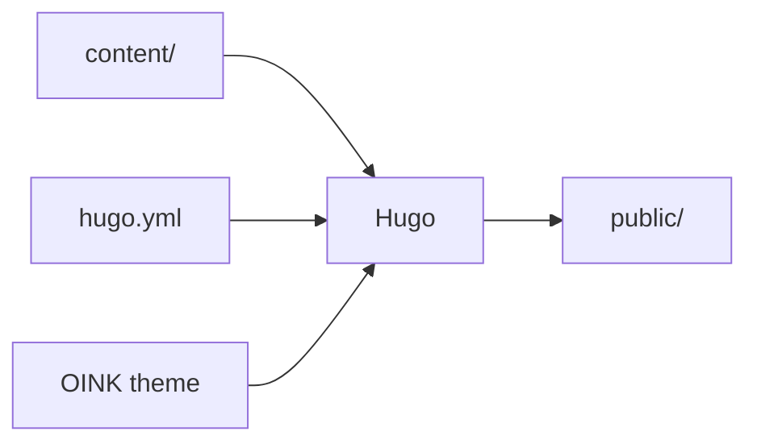
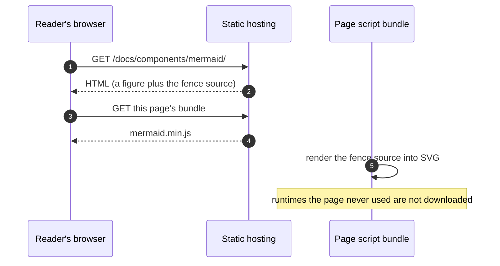
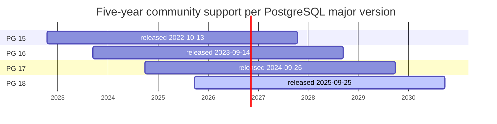
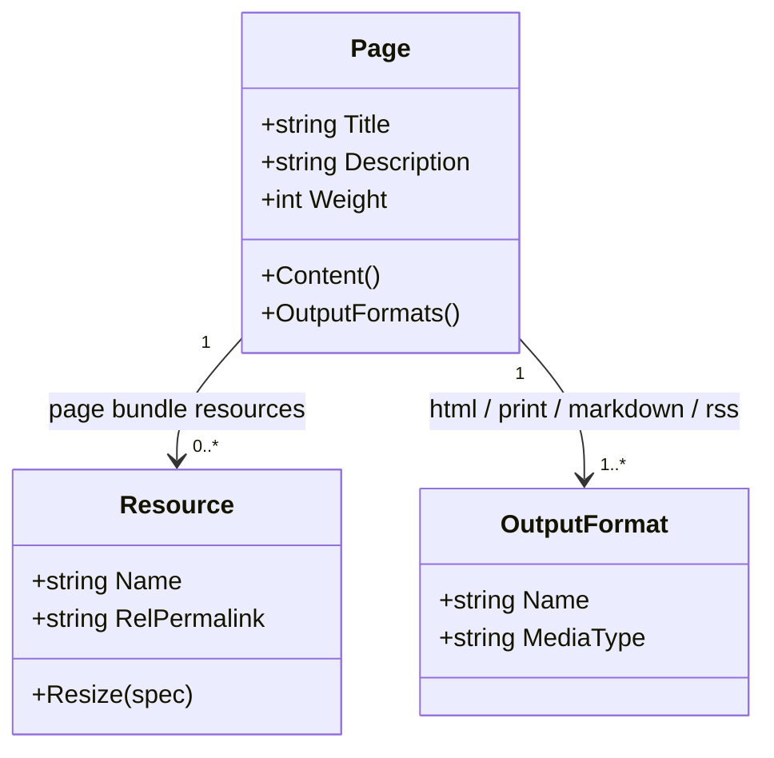
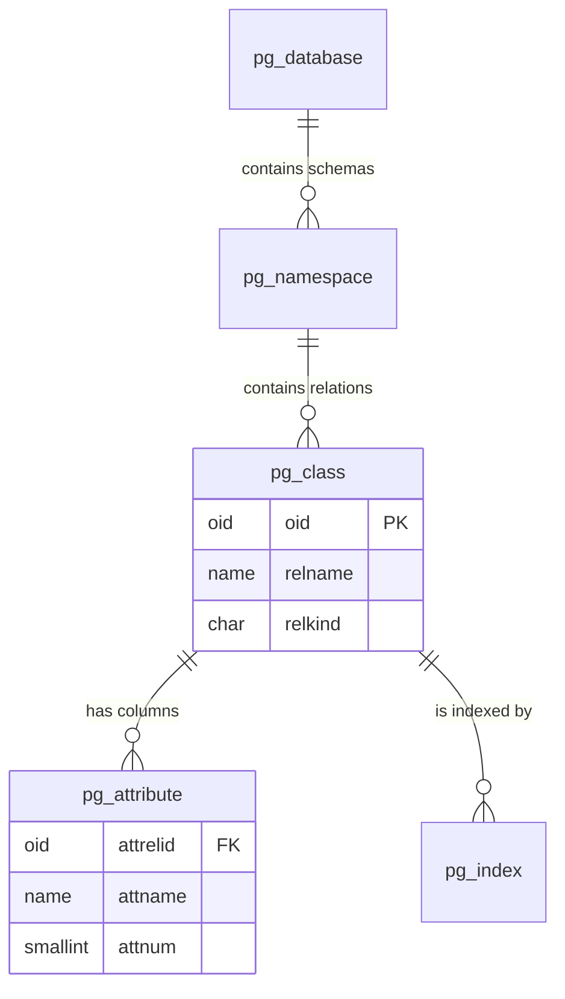
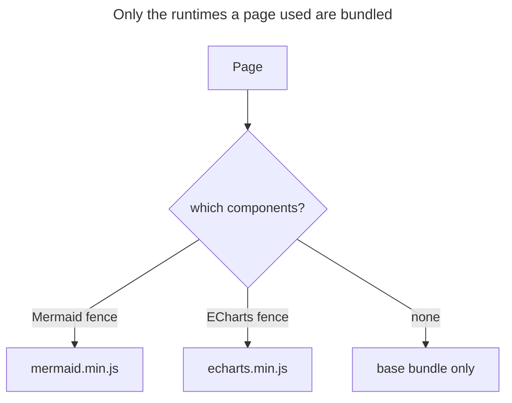
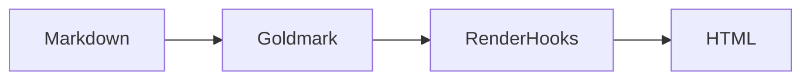
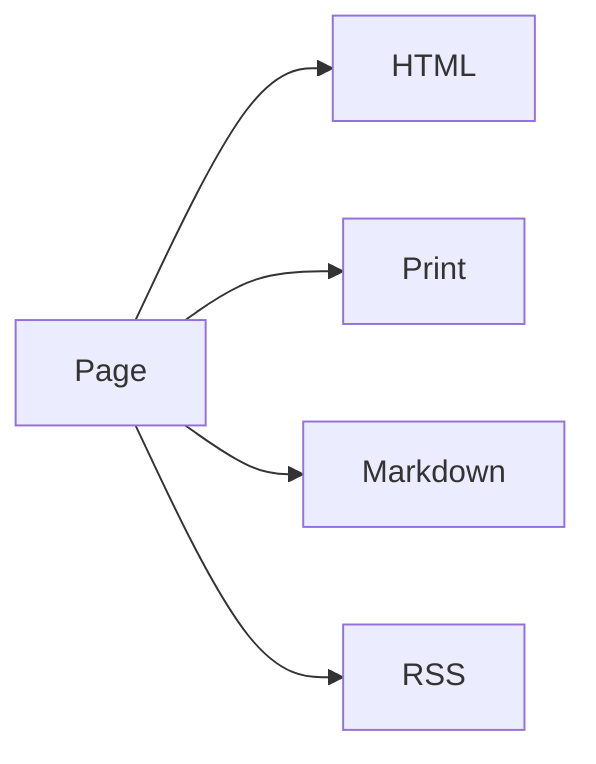

A `mermaid` fence displays text as a flowchart, sequence diagram, Gantt chart, class diagram, ER diagram, or state diagram.
Git stores the diagram source, diffs show changes, and search can find it.
The reader's browser renders it with bundled Mermaid. It contacts no external service.
If a diagram needs precise pixel control, use SVG as an [image](/docs/components/image/).

## Shortest form {#minimal}

````markdown {title="Source"}

````


Use `mermaid` as the fence language. No other switch is needed.
Only pages with this fence load the Mermaid runtime. Even ten diagrams on one page load it only once.

## Sequence diagrams {#sequence}

`sequenceDiagram` describes messages between participants over time. Use it for request paths and loading order.

````markdown {title="Source"}

````


## Gantt charts {#gantt}

`gantt` displays intervals. This example shows each PostgreSQL major version's five-year community support period, measured from release.
`1825d` means five years.

````markdown {title="Source"}

````


## Class and ER diagrams {#class-and-er}

`classDiagram` displays types and relationships. `erDiagram` displays entities and cardinality. Use either to explain a data model.

````markdown {title="Source"}

````


````markdown {title="Source"}

````


## State diagrams {#state}

`stateDiagram-v2` displays states and transition conditions.
This example shows five OINK release states. They are not interchangeable. A successful local build establishes none of them.

````markdown {title="Source"}

````


```mermaid
stateDiagram-v2
  [*] --> SourceComplete
  SourceComplete --> Validated : theme checks + site suite green
  Validated --> Published : an immutable signed vX.Y.Z tag is pushed
  Published --> Documented : the site's go.mod pins that tag
  Documented --> Deployed : the production build goes live
  Deployed --> [*]
  Published --> SourceComplete : a problem means a new patch version; tags never move
```

## Per-diagram title and configuration {#per-diagram-config}

A fence body can start with Mermaid's YAML header. This is not Hugo front matter.
`title` sets the diagram title. `config` overrides Mermaid configuration for this diagram only.
If a diagram fixes `config.theme`, it no longer follows the site's color scheme.

````markdown {title="Source"}

````


## Light and dark {#dark-mode}

At initialization, the theme reads the current color scheme. Dark mode uses Mermaid's `dark` theme.
Light mode uses the site's configured theme. Changing the color scheme redraws diagrams in place without reloading the page.
Each diagram keeps its height during redrawing, so page content does not move.

Put site-wide defaults in `hugo.yml` with lowercase keys. The theme maps them to Mermaid's key casing:

```yaml {title="hugo.yml"}
params:
  mermaid:
    theme: neutral
    flowchart:
      diagrampadding: 6
```

[Configuration](/docs/customize/config/) lists all keys.
See the [Mermaid configuration reference](https://mermaid.js.org/config/schema-docs/config.html) for accepted values.

## Inside tabs and steps {#compose}

A `mermaid` fence has no `tab` attribute. Adjacent-fence tabs apply only to ordinary code fences.
To compare two diagrams, use the `tabs` shortcode.

````markdown {title="Source"}








````










Each step in `{}` uses page-level Markdown and can contain a `mermaid` fence.
See [Steps](/docs/components/steps/).

## Output {#outputs}

| Output | Shape |
| --- | --- |
| HTML | A `figure` retaining readable source; the runtime draws SVG as it approaches the viewport |
| Print | The source inside `<pre class="td-mermaid-source">`, static — no runtime runs there |
| Markdown | The `mermaid` fence and its source, kept as written |
| RSS | The source inside `<pre class="td-mermaid-source">` — subscribers see text |

## Parameter reference {#reference}

A `mermaid` fence reads no attribute line. `{height=…}` and `{class=…}` have no effect and produce no error.
The diagram and container width determine the size. The diagram is centered.

Site parameters (`hugo.yml`):

| Parameter | Type | Default | Description |
| --- | --- | --- | --- |
| `params.mermaid` | map | unset | The whole map is passed to Mermaid's `initialize()`; write keys in lowercase and the theme matches them back to Mermaid's casing |
| `params.mermaid.theme` | string | Mermaid's default | The light-mode theme; dark mode forces `dark` |
{.fields meta="type default"}

Put per-diagram configuration (`title`, `config`) in the YAML header at the start of the fence body.
These are Mermaid keys, not theme parameters.

## Enlarging a diagram {#zoom}

> [!NOTE] Unreleased reading experience
> This shared viewer and demand loading are implemented in the local development
> version. They are not part of published v1.3.2.

Mermaid and local PlantUML share the corner-button viewer. It reuses the rendered
result without running the engine again. Drag or use arrow keys to pan; use the
wheel, pinch, `+` or `-` to zoom. Choose **Fit to window** or press `0` to see the
whole diagram. `Esc` closes the viewer and restores focus to its opener. Very wide
pictures initially open at natural size for readable labels. Controls retain touch
size on phones. Theme changes retain your position; reduced motion adds no animation.

Choose **Source** to inspect the original text and **Copy code** to copy it.
Arrows, quotes, ampersands and Chinese stay intact. **Download SVG** exports a
styled, standalone image requiring no remote resources. Copy/export failures show
feedback. “SVG download requested” means the browser received the request; the
browser controls final saving. An SVG with external image or style dependencies
cannot be exported. The source disclosure below each figure also supports copying.

## Demand loading and printing {#loading}

A visible diagram within 320px of the viewport loads its engine and renders.
Multiple diagrams share engines and both types render serially. Hidden tabs,
closed disclosures and zero-width containers wait until visible. Browsers without
IntersectionObserver use scroll and size checks. Rapid theme changes discard
obsolete results. Diagram-free pages load neither the viewer nor these engines.
No installation dependency or build step is added.

Disabled JavaScript, blocked engines and syntax errors retain readable source.
In the development checkout, ordinary HTML printing scales completed light
diagrams to the page. Dark diagrams and unrendered diagrams print black-on-white
source with wrapping, without waiting for an asynchronous engine or requiring
background printing. To print pictures throughout, switch to light mode, then
visit and expand the diagrams you need before printing. Printing restores source
disclosures afterward and does not change your appearance preference.
Dedicated Print, Markdown and RSS continue to show source.

## Limits {#limits}

- Mermaid emits inline SVG instead of ``, so `{#id num=}` numbering does not apply.
  If you need numbering, export an image and use [image](/docs/components/image/) numbering.
- Fence attributes have no effect. Control width through diagram syntax, such as flowchart direction or class-diagram layout, or CSS.
  There is no alignment attribute. Diagrams are always centered.
- Syntax errors appear only in the browser because Hugo does not parse Mermaid.
  Invalid diagrams display an alert and keep readable source, but the build still passes. Check the browser before publishing.
- RSS, Markdown, and Print include source instead of pictures. State conclusions in prose as well as in diagrams.

## Related {#related}

- [PlantUML](/docs/components/plantuml/) — UML diagrams; see its rendering modes and version requirements
- [Markmap](/docs/components/markmap/) — outline-shaped hierarchies
- [ECharts](/docs/components/echarts/) — charts with numbers in them
- [Images](/docs/components/image/) — hand-drawn SVG and numbering
