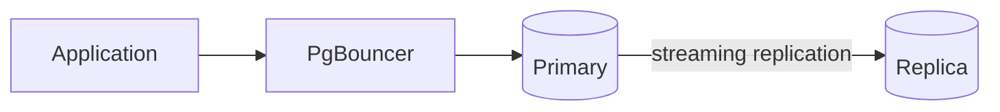
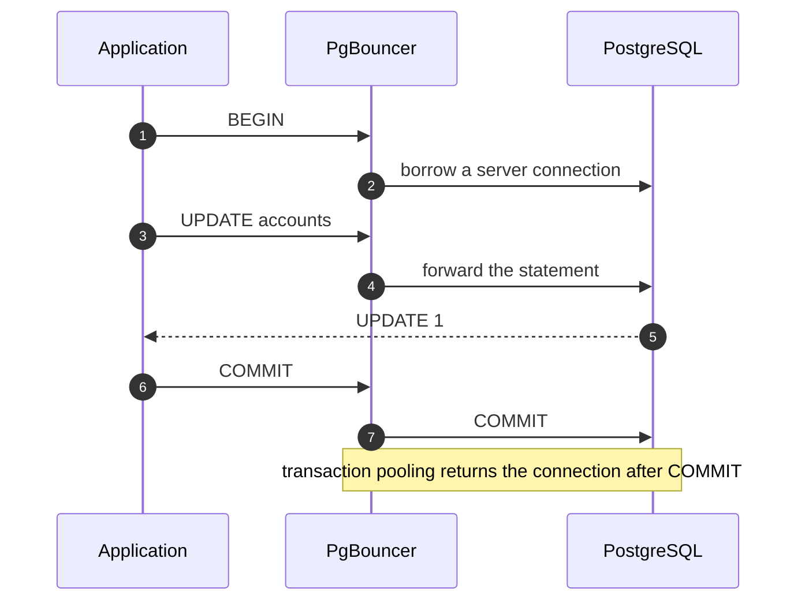
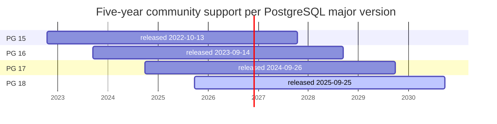
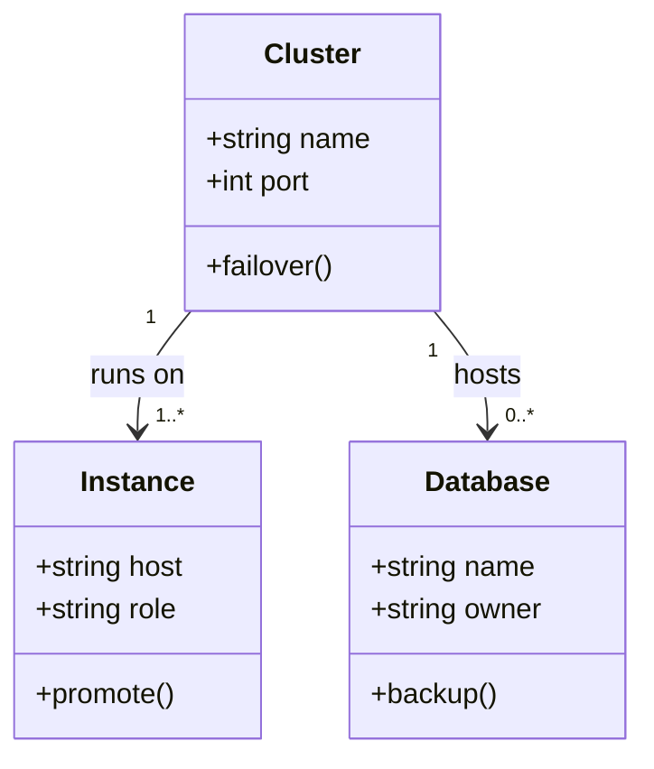
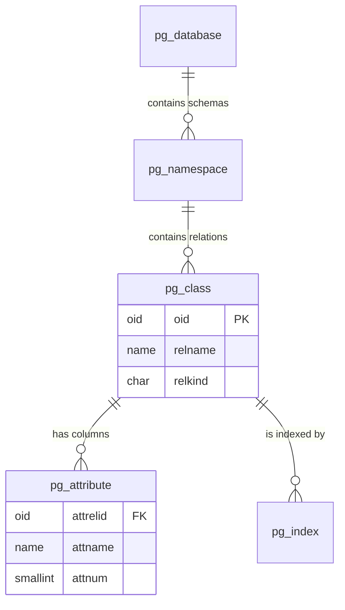
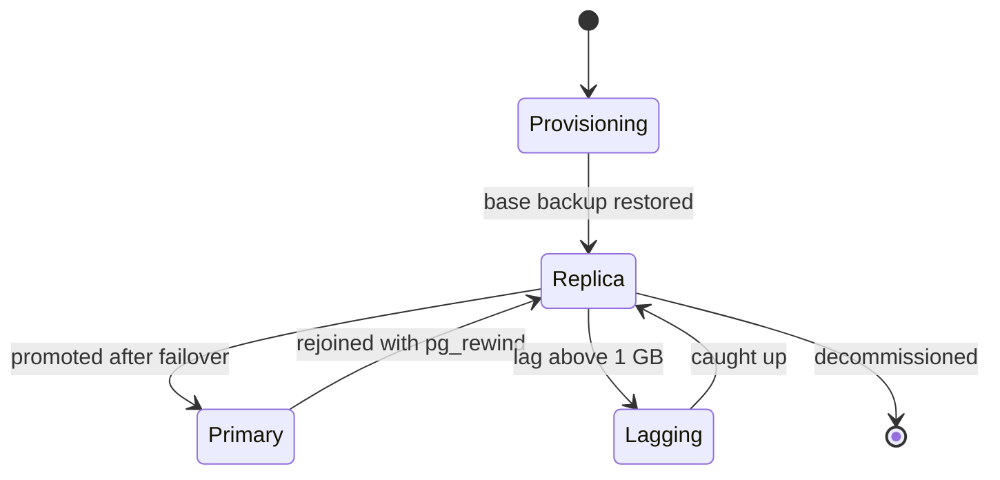
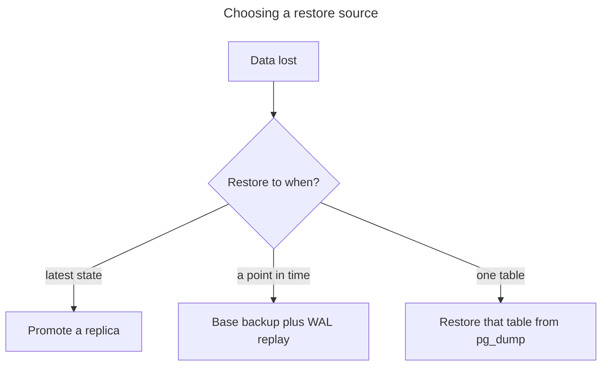
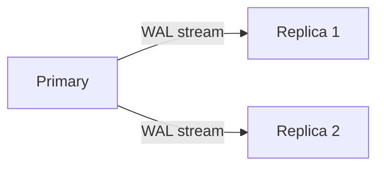
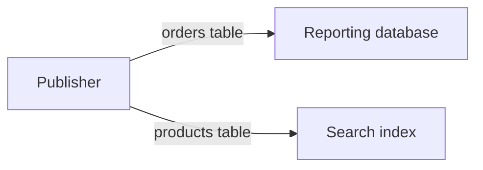

A `mermaid` fence turns a few lines of text into a flowchart, sequence
diagram, Gantt chart, class or ER diagram, or state diagram. Because the
diagram lives in the page as text, a change to it shows up in review as a
readable diff and site search finds the words in it, which a screenshot cannot
offer. The Mermaid engine ships with the theme and runs in the reader's
browser, so no external service sees your diagrams. When a picture needs
pixel-level control, draw it as SVG and add it as an
[image](/docs/components/image/).

## Shortest form {#minimal}

````markdown {title="Source"}

````


There is nothing to turn on: name the fence `mermaid`. Only pages that contain
such a fence load the Mermaid runtime, and they load it once however many
diagrams they hold.

## Sequence diagrams {#sequence}

`sequenceDiagram` shows messages passing between participants over time, which
suits request paths, handshakes and retries.

````markdown {title="Source"}

````


## Gantt charts {#gantt}

`gantt` draws intervals on a time axis. This chart shows the five years of
community support each PostgreSQL major version receives from its release
date; `1825d` is five years.

````markdown {title="Source"}

````


## Class and ER diagrams {#class-and-er}

Use `classDiagram` for types, their members and how they relate, and
`erDiagram` for entities and cardinality; both explain a data model faster
than a paragraph can.

````markdown {title="Source"}

````


````markdown {title="Source"}

````


## State diagrams {#state}

`stateDiagram-v2` shows states and the events that move between them, here the
roles a PostgreSQL instance passes through in a high-availability cluster.

````markdown {title="Source"}

````


## Per-diagram title and configuration {#per-diagram-config}

Start the fence body with Mermaid's own YAML header (it belongs to the diagram,
not to Hugo's front matter). `title` captions the diagram, and `config`
overrides Mermaid settings for this diagram alone. Leave `config.theme` out:
a diagram that sets it no longer follows the reader's light or dark mode.

````markdown {title="Source"}

````


## Light and dark {#dark-mode}

Diagrams follow the reader's color scheme: dark mode draws them with Mermaid's
`dark` theme, light mode with the theme your site configures. Switching
redraws them in place without a reload, and each diagram keeps its height
while it redraws, so the text around it does not jump.

Set site-wide defaults under `params.mermaid` in lowercase; the theme matches
each key back to Mermaid's own casing.

```yaml {title="hugo.yml"}
params:
  mermaid:
    theme: neutral
    flowchart:
      diagrampadding: 6
```

The [Mermaid configuration reference](https://mermaid.js.org/config/schema-docs/config.html)
lists the accepted keys and values.

## Inside tabs and steps {#compose}

The `tab` attribute that groups adjacent code fences into tabs does not apply
to `mermaid` fences. To let readers switch between two diagrams, put them in
the `tabs` shortcode.

````markdown {title="Source"}








````










A step of the `{}` shortcode is ordinary page Markdown, so it can
hold a `mermaid` fence too; see [Steps](/docs/components/steps/).

## Enlarging a diagram {#zoom}

Each diagram has a corner button that opens it in a viewer, the same one local
[PlantUML](/docs/components/plantuml/) diagrams use. The viewer reuses the
drawing already on the page instead of rendering it again. Drag or use the
arrow keys to pan; use the wheel, a pinch, `+` or `-` to zoom; choose **Fit to
window** or press `0` to see the whole diagram; press `Esc` to close it and
return focus to the button. A very wide diagram opens at its natural size so
its labels stay readable, controls keep a touch-friendly size on phones, a
color-scheme change keeps your place, and nothing animates when the reader
prefers reduced motion.

**Source** shows the original text and **Copy code** copies it with arrows,
quotes, ampersands and non-Latin text intact. **Download SVG** saves a styled,
self-contained image; a diagram that depends on external images or styles
cannot be exported, and a failed copy or export says so. The source disclosure
under each diagram can be opened and copied as well.

## Loading and output {#outputs}

A diagram renders once it is visible and within 320px of the viewport, so a
long page does not pay for diagrams the reader never reaches. Diagrams share
one engine and render one at a time. A diagram in a hidden tab, a closed
disclosure or a zero-width container waits until it is shown, and browsers
without IntersectionObserver fall back to scroll and resize checks. Pages
without diagrams load neither the engine nor the viewer.

When JavaScript is off, the engine is blocked or the diagram has a syntax
error, the reader sees the source instead. Printing a page from the browser
scales finished light-mode diagrams to the paper; dark-mode and not yet
rendered diagrams print as black-on-white source. To print pictures
throughout, switch to light mode and scroll through the diagrams you need,
opening any tabs or disclosures that hold them, before you print. Printing
leaves the reader's appearance setting untouched. The site's Print view, the
Markdown output and RSS always carry the source.

## Parameter reference {#reference}

Site parameters (`hugo.yml`):

| Parameter | Type | Default | Description |
| --- | --- | --- | --- |
| `params.mermaid` | map | unset | The whole map is passed to Mermaid's `initialize()`; write keys in lowercase and the theme matches them back to Mermaid's casing; keys absent from Mermaid's default config are dropped silently |
| `params.mermaid.theme` | string | `default` | The light-mode theme; dark mode always uses `dark`. Unless set, `layout: dagre` and `look: classic` are pinned as well |
{.fields meta="type default"}

Settings for one diagram (`title`, `config`) go in the YAML header at the
start of the fence body; they are Mermaid keys, not theme parameters.

Fence attributes accept only `class`, `data-*` and `aria-*`, which land on the
diagram's `<figure>` for site CSS. Any other key, such as `height` or `align`,
warns and is ignored: the diagram's own content and the column width set its
size, and it is always centered.

## Limits {#limits}

- A diagram is inline SVG rather than an ``, so `{#id num=}` numbering
  does not apply. To number one, export it as an image and use
  [image numbering](/docs/components/image/).
- To change a diagram's width, change the diagram itself (flowchart direction,
  class-diagram layout) or style its `class` in site CSS.
- Hugo does not parse Mermaid, so a syntax error does not fail the build. The
  page shows an alert and the source instead of the diagram, so open each
  changed diagram in a browser before you publish.
- Print, Markdown and RSS carry source rather than pictures, so state the
  conclusion in prose as well as in the diagram.

## Related {#related}

- [PlantUML](/docs/components/plantuml/) — UML diagrams, rendered locally or by a server you run
- [Markmap](/docs/components/markmap/) — outline-shaped hierarchies
- [ECharts](/docs/components/echarts/) — charts with numbers in them
- [Images](/docs/components/image/) — hand-drawn SVG and numbering
