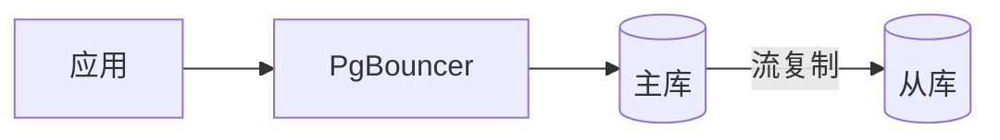
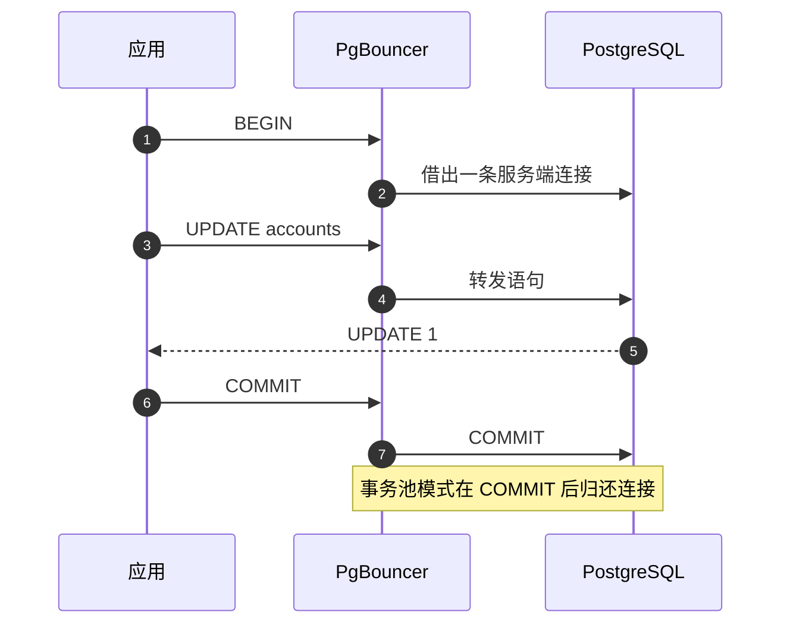
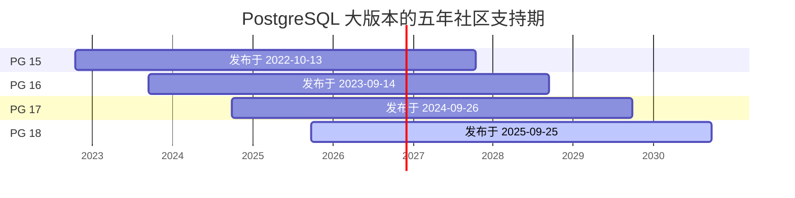
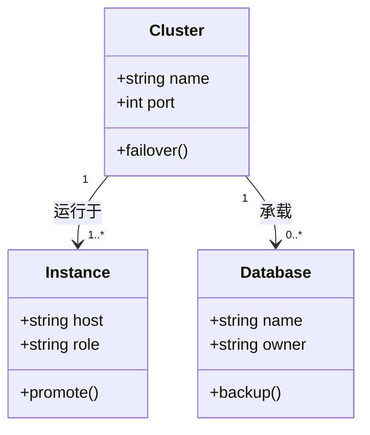
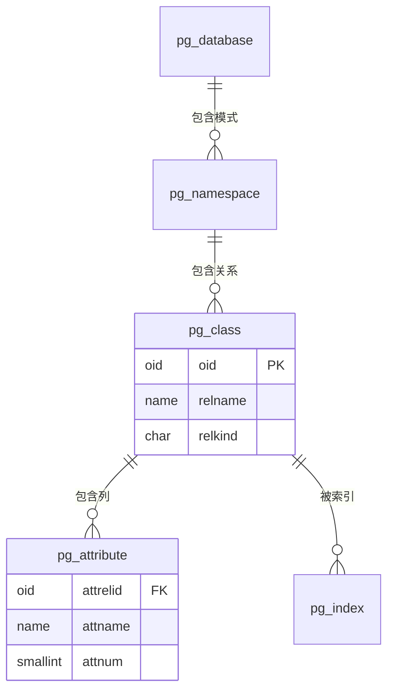
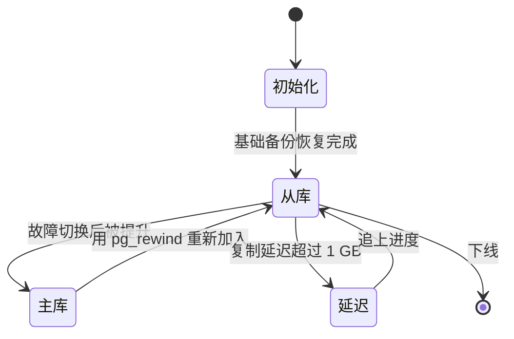
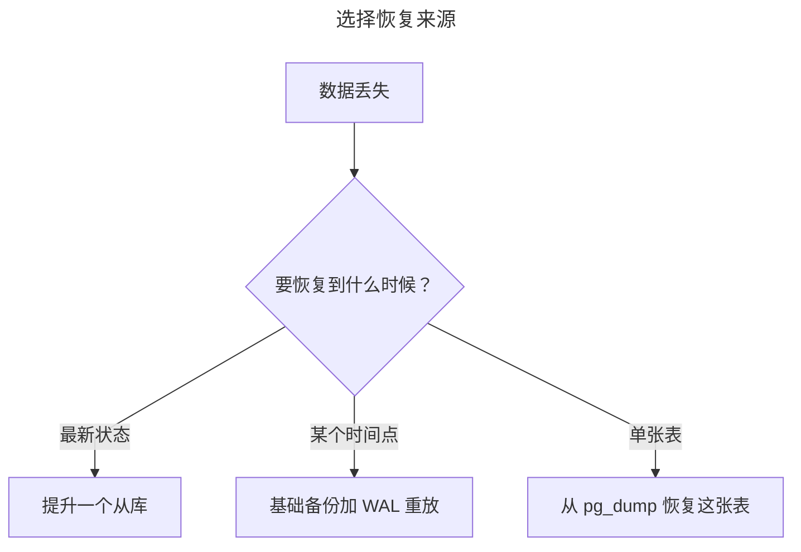
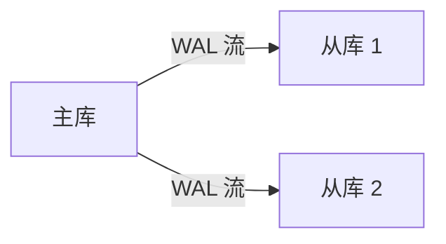
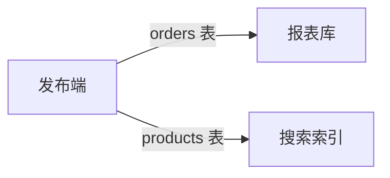

`mermaid` 围栏用几行文本画出流程图、时序图、甘特图、类图、ER 图或状态图。图以文本形式写在页面里，改动在评审时是一段看得懂的 diff，站内搜索也能搜到图里的文字，这些都是截图做不到的。Mermaid 引擎随主题提供，在读者浏览器里渲染，图的内容不会经过任何外部服务。需要像素级控制的示意图，画成 SVG 后按[图片](/zh/docs/components/image/)插入。

## 最简例子 {#minimal}

````markdown {title="源码"}

````


不需要任何开关，把围栏语言写成 `mermaid` 即可。只有包含这种围栏的页面才加载 Mermaid 运行时，而且无论页面里有几张图，都只加载一次。

## 时序图 {#sequence}

`sequenceDiagram` 描述参与者之间按时间先后传递的消息，适合讲请求链路、握手与重试。

````markdown {title="源码"}

````


## 甘特图 {#gantt}

`gantt` 在时间轴上画区间。下面是 PostgreSQL 各大版本从发布日算起的五年社区支持期，`1825d` 即五年。

````markdown {title="源码"}

````


## 类图与 ER 图 {#class-and-er}

`classDiagram` 画类型、成员以及它们之间的关系，`erDiagram` 画实体与基数。解释数据模型时，一张图往往比一段文字快得多。

````markdown {title="源码"}

````


````markdown {title="源码"}

````


## 状态图 {#state}

`stateDiagram-v2` 画状态以及触发状态迁移的事件。下面是高可用集群里一个 PostgreSQL 实例会经历的几种角色。

````markdown {title="源码"}

````


## 单张图的标题与配置 {#per-diagram-config}

围栏正文最前面可以写 Mermaid 自己的 YAML 头（它属于这张图，不是 Hugo 的 front matter）。`title` 给图加标题，`config` 只覆盖这一张图的 Mermaid 配置。不要在这里写 `config.theme`：写了它的图不再跟随读者的深浅色模式。

````markdown {title="源码"}

````


## 深浅色 {#dark-mode}

图跟随读者的配色模式：深色模式用 Mermaid 的 `dark` 主题，浅色模式用站点配置的主题。读者切换配色时，图就地重绘，页面不重新加载；重绘期间每张图保持原有高度，周围的文字不会跳动。

站点级默认值写在 `params.mermaid` 下，键名一律小写，主题会把它们匹配回 Mermaid 的大小写。

```yaml {title="hugo.yml"}
params:
  mermaid:
    theme: neutral
    flowchart:
      diagrampadding: 6
```

可用的键和取值见 [Mermaid 配置文档](https://mermaid.js.org/config/schema-docs/config.html)。

## 放进标签页与步骤 {#compose}

把相邻代码围栏合成标签页的 `tab` 属性，对 `mermaid` 围栏不起作用。要让读者在两张图之间切换，把它们放进 `tabs` shortcode。

````markdown {title="源码"}








````










`{}` 里的每一步都是普通的页面 Markdown，同样可以放 `mermaid` 围栏，见[步骤](/zh/docs/components/steps/)。

## 放大查看 {#zoom}

每张图的角上有一个按钮，点开是一个查看器，本地渲染的 [PlantUML](/zh/docs/components/plantuml/) 图也用它。查看器直接复用页面上已经画好的图，不会重新渲染。拖动或用方向键平移；滚轮、双指捏合、`+` 与 `-` 缩放；点「适应窗口」或按 `0` 显示整张图；按 `Esc` 关闭，焦点回到打开按钮。很宽的图初次打开时保持原始尺寸，方便看清文字；手机上的按钮保持便于触控的大小；切换深浅色不会丢失当前位置；读者设置了减少动态效果时不播放动画。

「源码」显示原始文本，「复制代码」复制它，箭头、引号、和号与中文都原样保留。「下载 SVG」保存一份带样式、不依赖外部资源的独立图片；依赖外部图片或样式的图无法导出，复制或导出失败时会给出提示。每张图下方的源码折叠区同样可以展开和复制。

## 加载与输出 {#outputs}

图进入视口、或距离视口不超过 320px 时才渲染，长页面不会为读者没看到的图付出代价。同页的图共用一个引擎，逐张渲染。隐藏标签页、未展开的折叠块和宽度为零的容器里的图，等到显示出来再渲染；没有 IntersectionObserver 的浏览器改用滚动与尺寸检查。没有图的页面既不加载引擎，也不加载查看器。

关闭 JavaScript、引擎被拦截或图的语法有错时，读者看到的是源码。从浏览器打印页面时，已经画好的浅色图按纸张宽度缩放；深色模式下的图和尚未渲染的图，打印成白底黑字的源码。想让打印稿里全是图，先切到浅色模式，把需要的图逐一滚动到、所在的标签页和折叠块也打开，再打印。打印不会改变读者的外观设置。站点的打印视图、Markdown 输出和 RSS 始终输出源码。

## 参数参考 {#reference}

站点参数（`hugo.yml`）：

| 参数 | 类型 | 默认 | 说明 |
| --- | --- | --- | --- |
| `params.mermaid` | map | 未设置 | 整个映射传给 Mermaid 的 `initialize()`；键名写小写，主题按 Mermaid 的大小写匹配回去；Mermaid 默认配置中没有的键会被静默丢弃 |
| `params.mermaid.theme` | string | `default` | 浅色模式下的主题；深色模式始终使用 `dark`。未设置时还固定使用 `layout: dagre` 与 `look: classic` |
{.fields meta="type default"}

单张图的配置（`title`、`config`）写在围栏正文开头的 YAML 头里，它们是 Mermaid 的键，不是主题参数。

围栏属性只接受 `class`、`data-*` 与 `aria-*`，它们会加在图的 `<figure>` 上，供站点 CSS 使用。其他键（如 `height`、`align`）会告警并被忽略：图的尺寸由图本身的内容和正文栏宽度决定，并且总是居中。

## 限制与常见问题 {#limits}

- 图是内联 SVG 而不是 ``，`{#id num=}` 编号不适用。需要编号时，把图导出成图片，按[图片编号](/zh/docs/components/image/)的方式使用。
- 要改变图的宽度，就改图本身（流程图的方向、类图的布局），或者在站点 CSS 里为它的 `class` 写样式。
- Hugo 不解析 Mermaid，语法错误不会让构建失败。页面上会显示一条提示和源码，而不是图，所以发布前要在浏览器里打开每一张改过的图看一眼。
- 打印、Markdown 与 RSS 里只有源码，没有图，结论要在正文里写出来，不能只画在图上。

## 相关 {#related}

- [PlantUML](/zh/docs/components/plantuml/) — UML 图，可本地渲染，也可交给自建服务
- [思维导图](/zh/docs/components/markmap/) — 大纲式的层级图
- [ECharts](/zh/docs/components/echarts/) — 有数值的统计图
- [图片](/zh/docs/components/image/) — 手绘 SVG、需要编号的图
