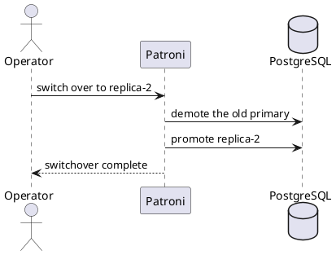
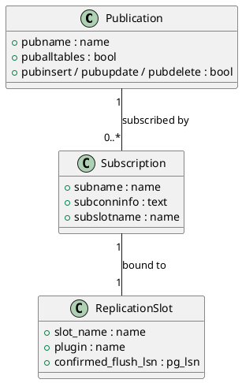
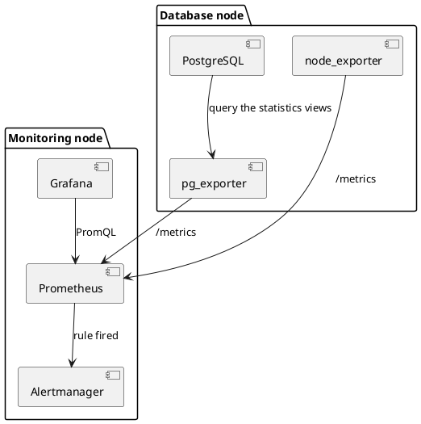
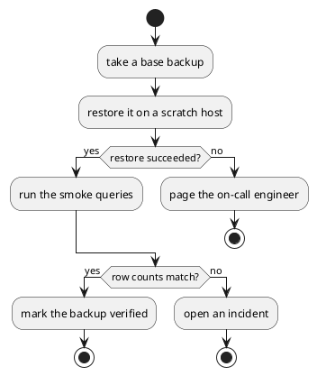
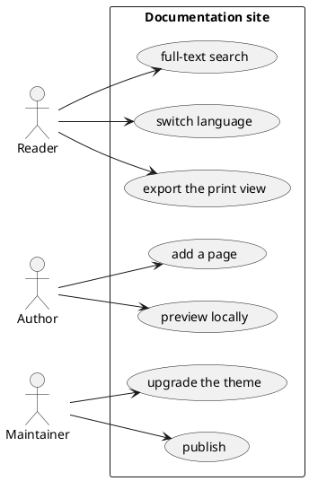

PlantUML is the text format many teams already use for UML: sequence, class,
component, activity and use-case diagrams. A `plantuml` fence renders it in
one of two ways, and you choose by what the diagrams need:

- **Local mode**, the default, renders in the reader's browser with two
  scripts that ship with the theme. It needs no Java, Graphviz, npm package,
  CDN or rendering service, and the diagram source never leaves the browser.
- **Server mode** sends each diagram to a PlantUML server you run, which you
  need only for features the browser bundle lacks, such as `!include` or the C4
  library. It requires an endpoint that you configure explicitly; OINK names
  none.

## Shortest form {#minimal}

PlantUML is off by default. Turn it on without an endpoint to get local mode:

```yaml {title="hugo.yml"}
params:
  plantuml: true
```

`plantuml: { enable: true }` is equivalent. Pages without a `plantuml` fence
load neither engine script. Then write the diagram in a fence:

````markdown {title="Source"}

````


The fence may leave out `@startuml` and `@enduml`; local mode adds them.

## Class diagram {#class}

Declare classes with their fields, then the relationships and their
cardinalities.



## Component diagram {#component}

Packages group components, and arrows show which one depends on which.



## Activity diagram {#activity}

Decisions and branches lay out a workflow, such as a backup verification job.



## Use-case diagram {#usecase}

Actors and use cases show what each kind of user can do with a system.



## Dark mode {#dark-mode}

In local mode, diagrams follow the reader's light or dark mode, and any
`skinparam` settings you write still apply. A mode change discards renders
that are no longer current, and an open viewer keeps its zoom and position.

## Enlarge, source and download {#zoom}

In local mode each diagram has a corner button that opens
[the same viewer as Mermaid](/docs/components/mermaid/#zoom): drag or use the
arrow keys to pan; use the wheel, a pinch, `+` or `-` to zoom; choose **Fit to
window** or press `0` to see it all; and press `Esc` to close it and return
focus to the button. The viewer reuses the image already on the page instead
of rendering again.

**Source** and **Copy code** keep arrows, quotes, ampersands and non-Latin
text intact. **Download SVG** saves a styled, self-contained file; a diagram
that depends on external resources cannot be exported, and a failure shows a
message in the toolbar. The source disclosure under each diagram can be opened
and copied too. Server mode shows the image your server returns, without the
viewer.

## Optional rendering service {#server}

Switch to server mode when your diagrams need what the browser bundle lacks
(see [Limits](#limits)) and you run a PlantUML server:

```yaml {title="hugo.yml"}
params:
  plantuml:
    enable: true
    svg_image_url: https://plantuml.internal.example/plantuml/svg/
    svg: false
```

A nonempty `svg_image_url` selects server mode; delete it, or leave it empty,
to return to local mode. The theme appends each encoded diagram to this URL,
so it must end with the path separator your server expects, usually `/`. It
must be an HTTP(S) URL with a host, or a same-site path. An invalid endpoint
warns and turns PlantUML rendering off instead of silently switching to local
mode.

Server mode sends each diagram's encoded source to that endpoint, so use a
server you trust with the content. `svg: true` inlines the returned SVG
instead of showing an image. Local mode ignores `svg` and always shows the
diagram as an image, so links and markup inside it never enter the page.

## Loading and output {#outputs}

In local mode, the two engine scripts load once per page, when the first
diagram comes within 320px of the viewport. A diagram in a hidden tab, a
closed disclosure or a zero-width container waits until it is shown, and
browsers without IntersectionObserver fall back to scroll and resize checks.
Mermaid and PlantUML diagrams render one at a time on the main thread.

When JavaScript is off, the engine fails to download, or a diagram uses
unsupported input or fails to render, the source stays readable, and the
other diagrams on the page still render. Printing from the browser keeps
rendered diagrams, scaled to the paper, and prints source for those not yet
rendered; it cannot wait for the engines, so scroll through the diagrams you
need, opening any tabs or disclosures that hold them, before you print. The
site's Print view, the Markdown output and RSS carry the original source and
make no rendering request.

## Parameter reference {#reference}

| Parameter | Type | Default | Description |
| --- | --- | --- | --- |
| `params.plantuml` | boolean or map | disabled | `true` enables local rendering |
| `params.plantuml.enable` | boolean | `false` | The switch in the map form |
| `params.plantuml.svg_image_url` | string | absent | Server endpoint; a nonempty value selects server mode |
| `params.plantuml.svg` | boolean | `false` | Server mode only: inline SVG instead of an image |
{.fields meta="type default"}

The fence takes none of the code-block attributes (title, copy, line numbers,
numbering, zoom); they warn and are ignored.

## Limits {#limits}

- The browser bundle contains the core engine and Graphviz layout only, so
  `!include`, `!includeurl`, external themes, C4, AWS and the other optional
  sprite libraries are not available. A diagram that uses them stays as
  source. Make it self-contained, use a pre-rendered
  [image](/docs/components/image/), or switch to [server mode](#server).
- The engine is `@plantuml/core` 1.2026.9 with Viz.js 3.31.0. The two scripts
  total about 4.7 MB, or 1.6 MB gzipped; they load only when a diagram
  approaches the viewport, and normal HTTP caching applies.
- Local rendering uses JavaScript and WebAssembly. A site with a strict
  Content Security Policy must allow its own scripts, `wasm-unsafe-eval` for
  WebAssembly compilation, and `blob:` images; when any of these is blocked,
  diagrams stay as source.
- Large diagrams cost the reader's CPU and memory, and rendering runs on the
  main thread rather than in a worker. If the engine hits a timeout it cannot
  cancel, the remaining PlantUML diagrams on the page stay as source until the
  page is reloaded.
- Diagrams are images, so links inside them are not clickable, and they cannot
  be numbered.

## Related {#related}

- [Mermaid](/docs/components/mermaid/) — another bundled browser diagram engine
- [Images](/docs/components/image/) — pre-rendered diagrams, numbering and zoom
- [Configuration](/docs/customize/config/) — site settings
