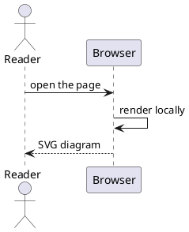
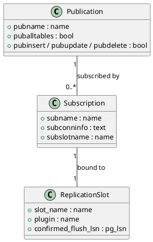
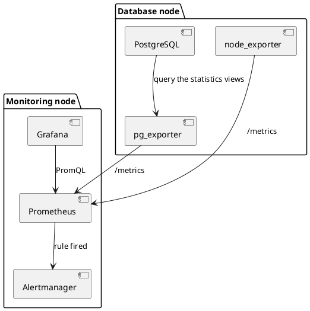
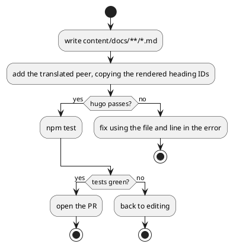
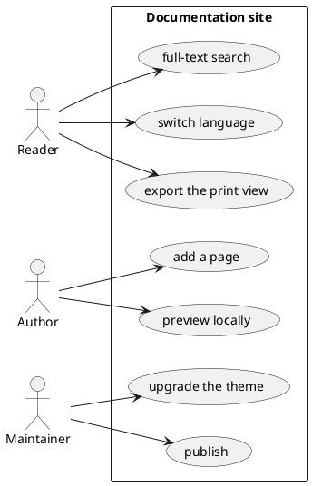

Write PlantUML source in a `plantuml` fence. OINK renders it in the reader's
browser with two bundled scripts. No Java, Graphviz executable, npm install,
CDN or rendering service is needed. Diagram source stays in the browser when
using local rendering.

> [!NOTE] Unreleased development change
> Local rendering is available in the development version of the theme.
> The published v1.3.2 theme still requires an explicit rendering endpoint.

Enable it in your site configuration:

```yaml {title="hugo.yml"}
params:
  plantuml: true
```

`plantuml: { enable: true }` also works. The default remains disabled. Enabled
pages without PlantUML fences do not load either engine script.

## Sequence diagram {#minimal}

Wrap the source in a `plantuml` fence. This live example renders entirely locally:

````markdown

````


## Class diagram {#class}

Declare classes, fields and relationship cardinalities.



## Component diagram {#component}

Packages group components; arrows show their dependencies.



## Activity diagram {#activity}

Use decisions and branches to explain a workflow.



## Use-case diagram {#usecase}

Actors and use cases describe what each reader can do.



## Dark mode {#dark-mode}

Local diagrams redraw when the reader switches between light and dark mode.
Authored `skinparam` settings still apply. Wide diagrams scroll horizontally
at their natural size, including on phones; keyboard users can focus the image
region to scroll it. Browser printing scales the rendered image to the page.

## Optional rendering service {#server}

Existing sites can keep an explicitly configured endpoint:

```yaml {title="hugo.yml"}
params:
  plantuml:
    enable: true
    svg_image_url: https://plantuml.internal.example/plantuml/svg/
    svg: false
```

A nonempty `svg_image_url` selects server rendering. Removing it selects local
rendering. The server URL must end with the appropriate path separator and be
an HTTP(S) URL with a host or a same-site path. Invalid endpoints warn and disable
rendering; they do not silently switch modes. OINK supplies no public endpoint.

Server mode sends encoded diagram source to that endpoint and retains its
existing `svg` option. Local mode ignores `svg`: generated SVG is displayed as
an image, so authored links and markup do not enter the page DOM.

## Outputs {#outputs}

| Output | Result |
| --- | --- |
| HTML | Local SVG image when enabled; readable source until rendering succeeds |
| Browser print of HTML | The rendered image, scaled to fit |
| Dedicated Print output | Readable source, with no PlantUML runtime |
| Markdown and RSS | Original diagram source; no rendering request |

With JavaScript disabled, a failed engine download, unsupported input or a
rendering error, the source remains readable. A failed diagram does not prevent
other diagrams on the page from rendering.

## Parameters {#reference}

| Parameter | Type | Default | Meaning |
| --- | --- | --- | --- |
| `params.plantuml` | boolean or map | disabled | `true` enables local rendering |
| `params.plantuml.enable` | boolean | `false` | Enables the map form |
| `params.plantuml.svg_image_url` | string | absent | Optional endpoint selecting legacy server rendering |
| `params.plantuml.svg` | boolean | `false` | Server mode only: inline SVG instead of an image |
{.fields meta="type default"}

Fences do not accept code-block title, copy, line-number, numbering or zoom
attributes. Source without `@startuml` / `@enduml` is wrapped for local rendering;
explicit diagram delimiters are preserved.

## Limits {#limits}

- The browser bundle includes the core engine and Graphviz layout only.
  `!include`, `!includeurl`, external themes, C4, AWS and other optional sprite
  libraries are not downloaded. Unsupported resources leave the source visible.
  Use self-contained diagrams, pre-rendered images, or an explicit server for these.
- The pinned engine is `@plantuml/core` 1.2026.9 with Viz.js 3.24.0. The two scripts
  total about 4.8 MB before compression, or 1.7 MB with gzip. Only enabled pages
  containing diagrams load them, and normal HTTP caching applies.
- Rendering uses the browser's JavaScript and WebAssembly support. Sites with a
  restrictive CSP need to allow their own scripts, WebAssembly compilation
  (`wasm-unsafe-eval`) and `blob:` images. Blocked resources retain source.
- Large diagrams still cost browser CPU and memory. Rendering proceeds one diagram
  at a time; this is not a background-worker renderer.
- Diagrams are images: SVG hyperlinks are inactive. Numbering and the Mermaid
  zoom dialog are not part of this integration.

## Related {#related}

- [Mermaid](/docs/components/mermaid/) — another bundled browser diagram engine
- [Images](/docs/components/image/) — pre-rendered diagrams, numbering and zoom
- [Configuration](/docs/customize/config/) — site settings
