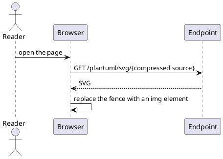
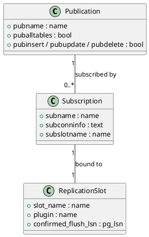
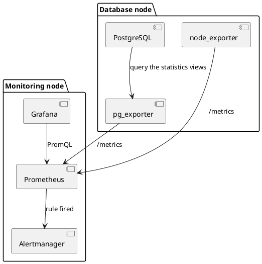
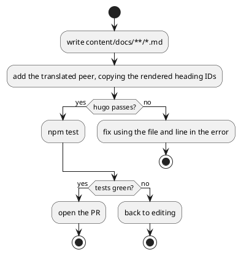
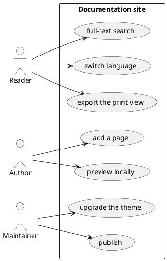
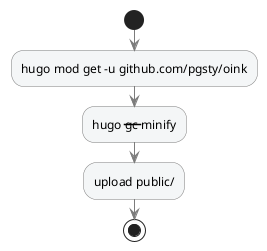

A `plantuml` fence contains PlantUML source. The browser compresses and encodes it, appends it to a server URL, and retrieves SVG.
Use it for sequence, class, component, activity, or use-case diagrams that need full UML features.
Rendering needs a server. The theme supplies no default endpoint.
`enable: true` without `svg_image_url` warns and leaves PlantUML disabled in ordinary previews. Review the warning and rendered fallback before publication.
Without a server, use [Mermaid](/docs/components/mermaid/).

> [!WARNING] This page shows source only, not rendered diagrams
> PlantUML needs a server that you run. This site does not assume an endpoint for readers.
> The current theme also double-escapes `<`, `>`, `&`, and `"` in `plantuml` fences.
> Sources with arrows or quotes therefore return a `Syntax Error?` image. See [Limits](#limits).
> Each example below is valid PlantUML source.

> [!IMPORTANT] Diagrams leave the reader's browser
> Encoded diagram source is sent to your configured endpoint.
> Never include passwords, internal hostnames, or customer names in PlantUML fences.
> Internal sites should run their own endpoint or use a pre-rendered [image](/docs/components/image/).

## Shortest form {#minimal}

Sequence diagrams are the most common type. `participant` declares a participant, `->` is a synchronous message, and `-->` is a return.

````markdown {title="Source"}

````

This creates four lanes and four messages. The reader opens the page, and the browser sends encoded source to the endpoint.
The endpoint returns SVG. The runtime replaces the fence with an image.

## Class diagrams {#class}

`class` lists members. `"1" -- "0..*"` sets relationship cardinality. Use this form to explain data models.

````markdown {title="Source"}

````

The diagram has three boxes with fields and two annotated connectors.
One publication can serve multiple subscriptions. Each subscription binds one replication slot.

## Component diagrams {#component}

`package` groups deployment units. `[component]` draws a box, and `-->` sets dependency direction.

````markdown {title="Source"}

````

The diagram has two dashed boxes, each with three components. Five labeled arrows show the collection path.

## Activity diagrams {#activity}

`start` / `stop` with `if … then … else … endif` defines a branching procedure.
Activity diagrams contain no arrow characters, so they are the only type that renders correctly in the current version.

````markdown {title="Source"}

````

The diagram has one vertical flow line, two diamonds with yes / no branches, and four endpoints.

## Use-case diagrams {#usecase}

`actor` draws a stick figure, `(use case)` draws an ellipse, and `rectangle` draws the system boundary.
Use this form to show who a system serves.

````markdown {title="Source"}

````

The diagram has three figures on the left and a box with seven ellipses on the right.
Connectors show each actor's available actions.

## Colours in dark mode {#dark-mode}

The server does not know the site's color scheme. Its SVG uses a fixed white background.
`skinparam backgroundColor transparent` removes that background. The diagram then uses the page background.
Neutral lines and text make it readable in both modes.

````markdown {title="Source"}

````

PlantUML's `!theme` directive also works, for example `!theme plain`.
Themes come from the server. Self-hosted endpoints must have them installed.

## The rendering server {#server}

The fence has no switch. Site configuration controls rendering:

```yaml {title="hugo.yml"}
params:
  plantuml:
    enable: true
    svg_image_url: https://plantuml.internal.example/plantuml/svg/
    svg: false
```

- `enable: true` without `svg_image_url` warns and disables rendering with
  `params.plantuml.enable requires an explicit params.plantuml.svg_image_url`.
  Review the warning and rendered fallback before publication. The theme never selects a public service.
- For self-hosting, use the official [`plantuml/plantuml-server`](https://github.com/plantuml/plantuml-server) image.
  Set `svg_image_url` to its `/svg/` path and **keep the trailing slash**. The encoded source is appended to it.
- Use an HTTP(S) URL or local path. Local paths honor the deployment subpath in `baseURL`.
  Whitespace, control characters, raw backslashes, protocol-relative URLs (`//host/`), and other schemes warn.
  The source block stays visible, and the PlantUML runtime does not load. Review the warning and rendered fallback before publication.
- The endpoint's CORS policy and the site's CSP `img-src` must allow it.
  When `svg: true`, `connect-src` must also allow it.

These keys are defined in
[Configuration](/docs/customize/config/).

## Output {#outputs}

| Output | Shape |
| --- | --- |
| HTML | The source is emitted as `<pre><code class="language-plantuml">`; once enabled, the runtime replaces it with an `` (with `svg: true`, an `<svg data-src>`) |
| Print | Same as HTML: the print view loads the runtime and requests the endpoint too |
| Markdown | The `plantuml` fence and its source, kept as written |
| RSS | The fence source only — subscribers see text |

If the feature is disabled or the runtime has not loaded, a readable source block remains. No broken-image icon appears.

## Parameter reference {#reference}

A `plantuml` fence reads no attribute line and bypasses OINK's code-block shell.
`title`, `copy`, and [Code blocks](/docs/components/code/) line-number options have no effect.

Site parameters (`hugo.yml`):

| Parameter | Type | Default | Description |
| --- | --- | --- | --- |
| `params.plantuml.enable` | bool | `false` | With it off, the fence stays a code block and no runtime loads |
| `params.plantuml.svg_image_url` | string | none | The rendering endpoint; the encoded source is appended to it. Required when `enable: true`, otherwise PlantUML warns and stays off |
| `params.plantuml.svg` | bool | `false` | `false` inserts ``; `true` inserts `<svg data-src>` and loads an external SVG loader, putting the SVG in the DOM where CSS can reach it |
{.fields meta="type default"}

The theme reads those three keys and nothing else.

## Limits {#limits}

- The current theme double-escapes `<`, `>`, `&`, and `"` in fences.
  Literal `--&gt;` and `&#34;` remain in the page, and the endpoint returns a `Syntax Error?` image.
  Diagrams with arrows, including sequence, component, use-case, and state diagrams, do not render.
  Activity diagrams without these characters do render. Until fixed, use [Mermaid](/docs/components/mermaid/) or a pre-rendered [image](/docs/components/image/).
- A server is mandatory. The theme supplies and assumes no default endpoint.
- Diagram source leaves the browser. Keep confidential information out of PlantUML fences.
- The server does not know the reader's color scheme. Use `skinparam` to control appearance.
- Runtime `` elements bypass the image render hook. `{#id num=}` numbering and image zoom do not apply.

## Related {#related}

- [Mermaid](/docs/components/mermaid/) — no server, follows the colour scheme, the everyday choice
- [Draw.io](/docs/components/drawio/) — the other integration that needs a server of your own
- [Images](/docs/components/image/) — pre-rendered SVG: numberable, zoomable, no external dependency
- [Configuration](/docs/customize/config/) — the full definition of `params.plantuml.*`
