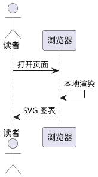
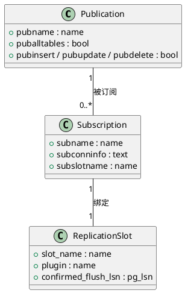
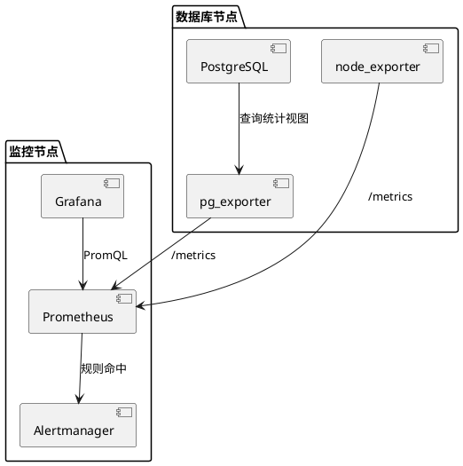
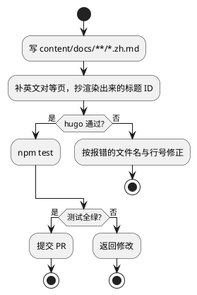
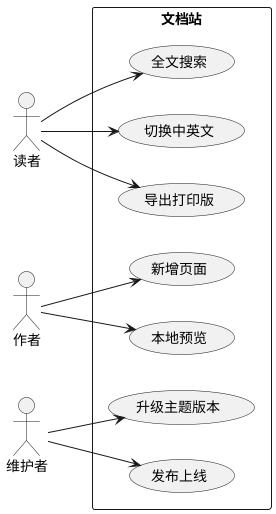

在 `plantuml` 围栏中写图表源码，OINK 使用随主题提供的两份脚本，在读者的浏览器中
完成渲染。无需安装 Java、Graphviz 可执行程序或 npm 包，也不依赖 CDN 或渲染服务。
使用本地渲染时，图表源码留在浏览器内。

> [!NOTE] OINK 1.4.0 的本地渲染
> 启用 PlantUML 且不配置端点时使用随主题提供的本地资源；显式端点继续选择服务端模式。

在站点配置中启用：

```yaml {title="hugo.yml"}
params:
  plantuml: true
```

`plantuml: { enable: true }` 同样有效。功能默认关闭；启用后，不含 PlantUML 围栏
的页面也不会加载这两份引擎脚本。

## 时序图 {#minimal}

将源码放入 `plantuml` 围栏。下面的示例完全在本地渲染：

````markdown

````


## 类图 {#class}

声明类、字段与关系基数。



## 组件图 {#component}

用包组织组件，用箭头表示依赖关系。



## 活动图 {#activity}

使用判断与分支说明工作流程。



## 用例图 {#usecase}

通过参与者与用例说明各类读者能做什么。



## 深色模式 {#dark-mode}

本地图表跟随深浅色切换，作者的 `skinparam` 设置仍然有效。切换时丢弃旧主题的
过期渲染结果；已打开的查看器保留缩放和平移位置。

## 放大、源码与下载 {#zoom}

本地 PlantUML 与 Mermaid 使用[同一查看器](/zh/docs/components/mermaid/#zoom)。
点击角上的放大按钮，拖动或用方向键平移，滚轮、双指、`+` 和 `-` 缩放，
“适应窗口”或 `0` 显示全图，`Esc` 关闭并恢复焦点。查看器复用 Blob 图片，
不会把 PlantUML 的 SVG 标记或链接插入页面 DOM，也不重复渲染。

“源码”和“复制代码”保留箭头、引号、和号及中文。“下载 SVG”导出带样式的
独立文件；有外部资源依赖时拒绝导出，失败有明确提示。页面的源码折叠区同样可查看和复制。显式服务端模式沿用旧行为。

## 按需加载与打印 {#loading}

图表距离视口不超过 320px 时才加载两份本地引擎；同页仅加载一次。隐藏标签页、
折叠区或宽度为零的容器在显示后处理。缺少 IntersectionObserver 时使用滚动和
尺寸检查。Mermaid 与 PlantUML 在主线程串行执行，没有新增安装依赖或构建步骤。

普通浏览器打印保留已渲染图片，并为尚未渲染的图显示源码。它不会等待异步引擎；
需要全是图片时，先浏览并展开需要的图。独立 Print、Markdown 与 RSS 保持源码回退。

## 可选渲染服务 {#server}

已有站点可以继续使用显式配置的端点：

```yaml {title="hugo.yml"}
params:
  plantuml:
    enable: true
    svg_image_url: https://plantuml.internal.example/plantuml/svg/
    svg: false
```

非空的 `svg_image_url` 选择服务端渲染，删除该设置则使用本地渲染。
端点应保留所需的末尾路径分隔符，使用包含主机的 HTTP(S) URL 或同站路径。
非法端点会告警并关闭渲染，不会静默切换模式。OINK 不提供默认公共端点。

服务端模式会把编码后的图表源码发送到端点，并保留原有的 `svg` 选项。
本地模式忽略 `svg`：生成的 SVG 通过图片展示，图内链接与标记不会进入页面 DOM。

## 输出形态 {#outputs}

| 输出 | 呈现 |
| --- | --- |
| HTML | 启用后显示本地 SVG 图片；渲染成功前保留可读源码 |
| 浏览器打印 HTML | 已渲染图片按纸张宽度缩放；未渲染的图显示源码 |
| 独立 Print 输出 | 可读源码，不加载 PlantUML 运行时 |
| Markdown 与 RSS | 原始图表源码，不发送渲染请求 |

JavaScript 关闭、引擎下载失败、输入不受支持或渲染出错时，源码仍然可读。
一张图失败不会阻止同页其它图表渲染。

## 参数参考 {#reference}

| 参数 | 类型 | 默认 | 说明 |
| --- | --- | --- | --- |
| `params.plantuml` | boolean 或 map | 关闭 | `true` 启用本地渲染 |
| `params.plantuml.enable` | boolean | `false` | 使用 map 形式时的开关 |
| `params.plantuml.svg_image_url` | string | 无 | 可选端点，填写后选择原有服务端模式 |
| `params.plantuml.svg` | boolean | `false` | 仅服务端模式有效：使用内联 SVG 而非图片 |
{.fields meta="type default"}

围栏不接受代码块的标题、复制按钮、行号、编号或缩放属性。本地渲染会为省略
`@startuml` / `@enduml` 的源码补上包围标记；显式写出的图表起止标记保持不变。

## 限制与常见问题 {#limits}

- 浏览器资源只包含核心引擎与 Graphviz 布局库，不会下载 `!include`、`!includeurl`、
  外部主题、C4、AWS 或其它可选图标库。不支持的资源会保留源码。
  此类内容请改写为自包含图表、使用预渲染图片，或显式配置服务端。
- 固定引擎为 `@plantuml/core` 1.2026.9，布局库为 Viz.js 3.24.0。两份脚本未压缩时
  合计约 4.8 MB，gzip 后约 1.7 MB；只在启用且图表接近视口时加载，可正常使用 HTTP 缓存。
- 渲染使用浏览器的 JavaScript 和 WebAssembly。设有严格 CSP 的站点需要允许
  同站脚本、WebAssembly 编译（`wasm-unsafe-eval`）与 `blob:` 图片；资源被拦截时保留源码。
- 大图仍然会消耗浏览器 CPU 和内存。运行时逐张渲染，不在后台 Worker 中执行。
  若引擎发生不可取消的超时，剩余 PlantUML 图保留源码，刷新页面后才能重试。
- 图表以图片呈现，SVG 超链接不可点击。本集成不提供编号。

## 相关 {#related}

- [Mermaid](/zh/docs/components/mermaid/) — 同样随主题提供的浏览器图表引擎
- [图片](/zh/docs/components/image/) — 预渲染图表、编号与缩放
- [配置总览](/zh/docs/customize/config/) — 站点配置
