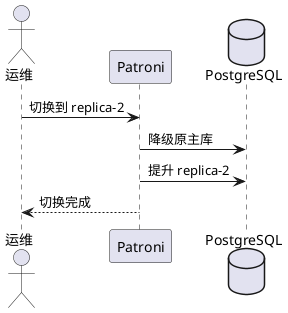
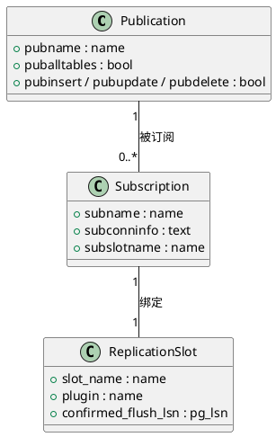
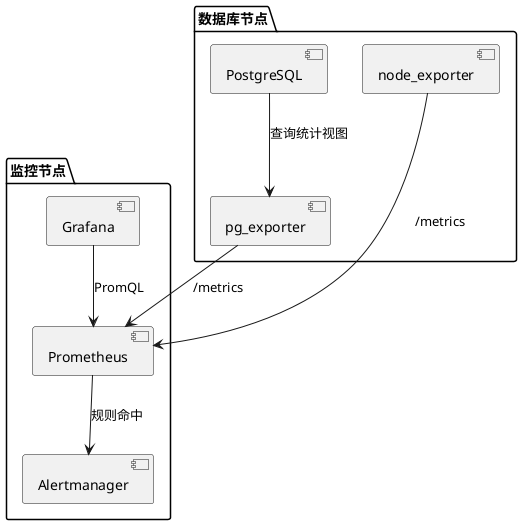
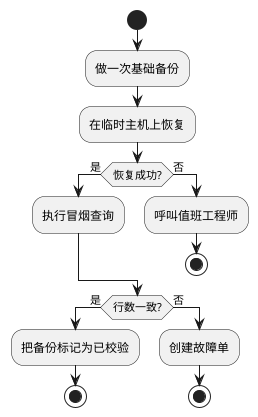
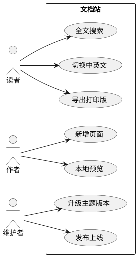

PlantUML 是很多团队早已在用的 UML 文本格式，时序图、类图、组件图、活动图、用例图都能画。`plantuml` 围栏有两种渲染方式，按图的需要选择：

- **本地模式**（默认）：用随主题提供的两份脚本在读者浏览器里渲染。不需要 Java、Graphviz、npm 包、CDN 或渲染服务，图表源码也不会离开浏览器。
- **服务端模式**：把每张图发给你自己运行的 PlantUML 服务器。只有用到浏览器资源里没有的功能（如 `!include`、C4 图库）时才需要它。必须显式配置端点，OINK 不提供任何默认端点。

## 最简例子 {#minimal}

PlantUML 默认关闭。打开它、但不配置端点，就是本地模式：

```yaml {title="hugo.yml"}
params:
  plantuml: true
```

写成 `plantuml: { enable: true }` 效果相同。不含 `plantuml` 围栏的页面不加载这两份引擎脚本。然后把图写进围栏：

````markdown {title="源码"}

````


围栏里可以省略 `@startuml` 与 `@enduml`，本地模式会自动补上。

## 类图 {#class}

先声明类及其字段，再写类之间的关系与基数。



## 组件图 {#component}

用包把组件分组，用箭头表示谁依赖谁。



## 活动图 {#activity}

用判断与分支铺开一个工作流程，比如一次备份校验任务。



## 用例图 {#usecase}

用参与者与用例说明每类用户能用系统做什么。



## 深色模式 {#dark-mode}

本地模式下，图跟随读者的深浅色模式切换，你写的 `skinparam` 设置依然有效。切换时会丢弃已经过时的渲染结果，已打开的查看器保留缩放比例与位置。

## 放大、源码与下载 {#zoom}

本地模式下，每张图的角上有一个按钮，打开的是[与 Mermaid 相同的查看器](/zh/docs/components/mermaid/#zoom)：拖动或用方向键平移；滚轮、双指捏合、`+` 与 `-` 缩放；点「适应窗口」或按 `0` 显示整张图；按 `Esc` 关闭，焦点回到按钮上。查看器直接复用页面上已有的图片，不会重新渲染。

「源码」和「复制代码」原样保留箭头、引号、和号与中文。「下载 SVG」保存一份带样式的独立文件；依赖外部资源的图无法导出，失败时工具栏会给出提示。每张图下方的源码折叠区同样可以展开和复制。服务端模式只显示服务器返回的图片，没有查看器。

## 可选渲染服务 {#server}

图需要浏览器资源里没有的功能（见[限制](#limits)），而你又运行着一台 PlantUML 服务器时，改用服务端模式：

```yaml {title="hugo.yml"}
params:
  plantuml:
    enable: true
    svg_image_url: https://plantuml.internal.example/plantuml/svg/
    svg: false
```

`svg_image_url` 非空即为服务端模式；删掉它或留空，就回到本地模式。主题把编码后的图直接拼接在这个 URL 后面，所以它必须以服务器要求的路径分隔符结尾，通常是 `/`。它必须是带主机名的 HTTP(S) URL，或同站路径。端点不合法时会告警并关闭 PlantUML 渲染，不会悄悄改用本地模式。

服务端模式会把每张图编码后的源码发给这个端点，请使用你信得过的服务器。`svg: true` 把服务器返回的 SVG 内联到页面里，而不是以图片显示。本地模式忽略 `svg`，总是以图片显示，图里的链接和标记不会进入页面。

## 加载与输出 {#outputs}

本地模式下，第一张图距离视口不超过 320px 时，两份引擎脚本才加载，同一页只加载一次。隐藏标签页、未展开的折叠块和宽度为零的容器里的图，等显示出来再渲染；没有 IntersectionObserver 的浏览器改用滚动与尺寸检查。Mermaid 与 PlantUML 的图在主线程上逐张渲染。

关闭 JavaScript、引擎下载失败、图里用了不支持的内容或渲染出错时，源码依然可读，同页其他图照常渲染。从浏览器打印时，已渲染的图按纸张宽度缩放，尚未渲染的图打印成源码。打印无法等待引擎加载，所以需要整套图时，先把要用的图逐一滚动到、所在的标签页和折叠块也打开，再打印。站点的打印视图、Markdown 输出与 RSS 输出原始源码，不发送渲染请求。

## 参数参考 {#reference}

| 参数 | 类型 | 默认 | 说明 |
| --- | --- | --- | --- |
| `params.plantuml` | boolean 或 map | 关闭 | `true` 启用本地渲染 |
| `params.plantuml.enable` | boolean | `false` | map 形式的开关 |
| `params.plantuml.svg_image_url` | string | 无 | 服务端端点；非空即选择服务端模式 |
| `params.plantuml.svg` | boolean | `false` | 仅服务端模式有效：内联 SVG 而不是图片 |
{.fields meta="type default"}

围栏不接受代码块的任何属性（标题、复制、行号、编号、缩放），写了会告警并被忽略。

## 限制与常见问题 {#limits}

- 浏览器资源只包含核心引擎和 Graphviz 布局库，`!include`、`!includeurl`、外部主题、C4、AWS 以及其他可选图标库都用不了，用到它们的图保留为源码。可以把图改成自包含的，改用预渲染的[图片](/zh/docs/components/image/)，或者切换到[服务端模式](#server)。
- 引擎为 `@plantuml/core` 1.2026.10，布局库为 Viz.js 3.31.0。两份脚本合计约 4.6 MB，gzip 后约 1.5 MB；只在图接近视口时加载，可以正常利用 HTTP 缓存。
- 本地渲染依赖 JavaScript 和 WebAssembly。设置了严格内容安全策略（CSP）的站点，需要允许同站脚本、用于 WebAssembly 编译的 `wasm-unsafe-eval`，以及 `blob:` 图片；其中任何一项被拦截，图都会保留为源码。
- 大图会消耗读者的 CPU 和内存，而且渲染在主线程上进行，不在 Worker 里。引擎一旦遇到无法取消的超时，本页剩余的 PlantUML 图保留源码，刷新页面后才会重试。
- 图以图片呈现，里面的链接不可点击，也不能编号。

## 相关 {#related}

- [Mermaid](/zh/docs/components/mermaid/) — 同样随主题提供的浏览器图表引擎
- [图片](/zh/docs/components/image/) — 预渲染图表、编号与缩放
- [配置总览](/zh/docs/customize/config/) — 站点配置
