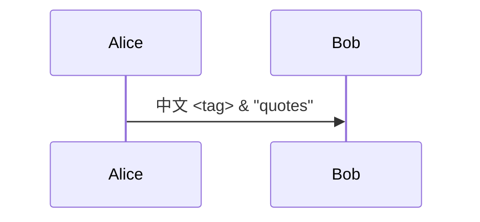
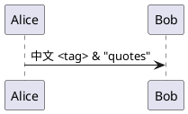
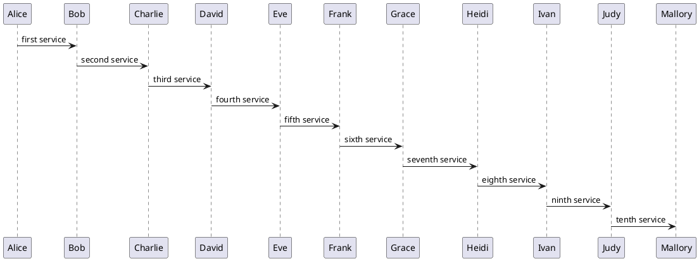
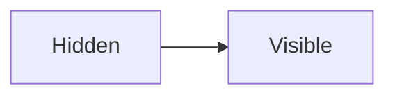
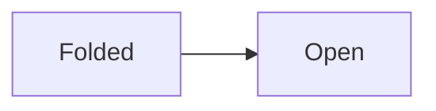
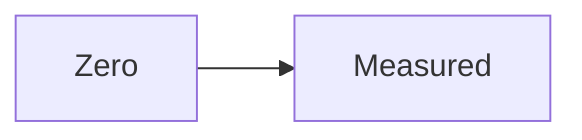
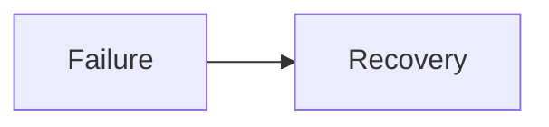

This long introduction keeps every diagram beyond the initial viewport.

<div style="min-height: 1800px" aria-hidden="true"></div>

## Mermaid source



<div style="min-height: 900px" aria-hidden="true"></div>

## PlantUML source



## Wide Mermaid

```mermaid
flowchart LR
 A[Author writes Markdown] --> B[Hugo renders content] --> C[Select local runtime] --> D[Wait until near viewport] --> E[Initialize shared engine] --> F[Render one diagram] --> G[Discard obsolete result] --> H[Display diagram] --> I[Open viewer] --> J[Pan and zoom] --> K[View original source] --> L[Download SVG]
```



## Wide PlantUML



## Hidden tabs



Select the second tab to render its diagrams.




```plantuml
Alice -> Bob: Revealed tab
```



## Closed disclosure

<details data-diagram-fold><summary>More diagrams</summary>



```plantuml
Alice -> Bob: Revealed disclosure
```

</details>

## Zero-width container

<div id="diagram-zero" style="width:0;overflow:hidden">



```plantuml
Alice -> Bob: Restored width
```

</div>

## Errors and recovery

```mermaid
not a valid diagram ?!?!
```

```plantuml
@startuml
!includeurl https://remote.invalid/unavailable.puml
Alice -> Bob
@enduml
```



```plantuml
Alice -> Bob: Still works
```
