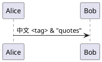
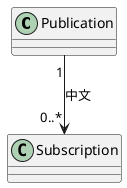
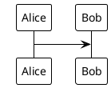

## Source fidelity



## Graphviz layout



## Invalid syntax

```plantuml
@startuml
this is not a valid PlantUML diagram ?!?!
@enduml
```

## Missing standard library


## Missing theme



## Remote include

```plantuml
@startuml
!includeurl https://remote.invalid/private.puml
Alice -> Bob
@enduml
```

## Local include

```plantuml
@startuml
!include private.puml
Alice -> Bob
@enduml
```

## Valid diagram after errors

```plantuml
Alice -> Bob: Still works
```
